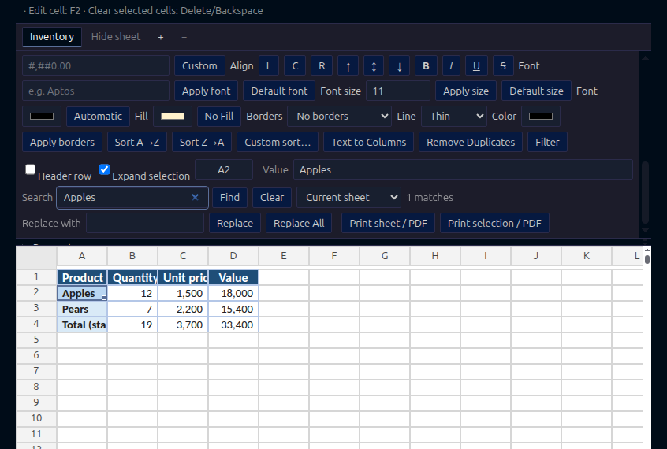

# JinSheet

[Install from the VS Code Marketplace](https://marketplace.visualstudio.com/items?itemName=jjeabydev.jinsheet) · [Report an issue](https://github.com/jjeabydev/jinsheet/issues)

JinSheet lets you edit CSV, TSV, and supported Excel workbooks, and preview Office and PDF files in VS Code. Files stay on your computer.

The interface follows VS Code's display language: Korean when the language code is `ko` or starts with `ko-`; English is the default for every other language.

## Features

- Create a blank XLSX workbook with **JinSheet: New Workbook** from the Command Palette; JinSheet opens it ready for editing.
- The complete toolbar starts collapsed to give the grid more room. Choose **Show menu** to access the cell address, formula bar, Find, Replace, and commands. **Ctrl/Cmd+F** opens the menu and focuses Find; **Ctrl/Cmd+G** opens it and focuses the cell address box.

- Insert or remove manual page breaks above the active row or left of the active column, reset stored breaks, and choose down-then-across or across-then-down printing order. Header markers show break positions without changing cell formatting.

- Save XLSX left/center/right headers and footers, first-page and odd/even variants, dynamic page counts, file/sheet names and a custom first page number. Browser export keeps them in the page margins.

- Save rows and columns to repeat on every printed page, including titles outside the print area. Hidden titles are omitted; body cells remain once in their own page bands.

- Save the selection as an XLSX print area, clear it, and print the saved area from **Print sheet / PDF**. Areas follow row/column changes and sheet rename/reordering, with undo and redo.

- Save XLSX page setup (A4, A3 or Letter; portrait or landscape; margins, scale or fit-to-pages, gridlines and row/column headings) with undo and redo.
- Export a CSV, TSV or XLSX sheet or selection as paginated HTML, then use its **Print / Save PDF** button in a browser. Unsaved values, calculated formulas, cell formatting, merged cells and hidden rows/columns are reflected.

- Drag the bottom edge of a row header to resize the row or selected rows; double-click it to auto-fit. Escape or leaving the window cancels a drag. A focused boundary supports Arrow Up/Down in 1 pt steps.

- Toggle **Wrap text** for selected XLSX cells and use **Auto-fit row** to size rows using the browser's actual font measurements. Wrap changes resize automatic rows as one undoable operation and keep manually set heights. Merged cells are excluded from auto-fit. Automatic rows recalculate after changes to content, formatting, formulas, or column widths; manually sized rows stay fixed. Height calculations add no separate undo step. Saving waits up to two seconds for pending measurements.

- Set selected XLSX row heights in points or restore their default height. A single operation supports up to 10,000 rows or the whole worksheet; applying a height to all rows updates the default without creating a million row elements.
- Display saved XLSX row heights, default row heights, and wrapped text; scrolling, selection, merged cells, and frozen rows use the stored dimensions.

- In XLSX, press **AutoSum** or **Alt+=** to insert `SUM` for a contiguous numeric range above or to the left; a range inside an AutoFilter uses `SUBTOTAL(9,…)`.
- Create native XLSX tables from a selected range. The selection's first row becomes text headers; blank and duplicate names are made unique. Body values and formulas are retained, and table creation supports undo and redo.
- Open supported XLSX shared formulas with each cell's relative references. Editing a group cell or pasting across group cells saves the changes and expands untouched formulas while preserving their results. Row and column structure edits also flatten remaining groups and update references; array formula cells remain protected.
- Freeze the top row, first column, or rows and columns above the active cell in supported XLSX workbooks; unfreeze them from the toolbar.
- Group selected XLSX rows or columns up to seven outline levels. Bracket markers in row and column headers show expanded group boundaries and nesting. Use the −/+ summary-header controls and numbered outline controls to collapse or expand groups; groups sharing one summary position change together. XLSX group state is saved and supports undo and redo. CSV and TSV also support row and column hiding and grouping during the editing session, including summary-header controls and undo and redo, but those formats cannot save outline metadata.
- Merge and unmerge selected XLSX cells from the toolbar. Merging asks before clearing values or formulas outside the top-left cell; both actions support undo and redo.
- Edit CSV, TSV, and supported XLSX workbooks. Find and replace text in the current sheet or entire XLSX workbook, sort a selected range by the active column (including supported formulas, which are ordered by their calculated values), copy displayed cell values, and paste cell ranges from the selection anchor. Find cycles through workbook matches and switches sheets as needed. Replace changes the current matching cell; Replace All changes all matching cells in the selected scope. Formula cells are skipped and reported, formatting is preserved, and workbook-wide replacement is a single undo/redo operation. Pasting one cell fills the selected range. A rectangular clipboard block repeats across a selected range when its dimensions divide the selection evenly. CSV and TSV files expand when you type into an empty grid cell or paste beyond their current rows or columns, up to the supported grid limits.
- Preview cached bar, line, area, scatter, pie, and doughnut charts in XLSX workbooks. Edit chart titles and series names, and insert column, line, area, pie, or doughnut charts from a selected rectangular range with a header row, category column (numeric X values for scatter), and numeric series (pie and doughnut charts use one series; limits are 1,000 cells and 32 charts per worksheet). Supported chart workbooks preserve their drawing parts during cell and format edits, and update chart previews before saving when source values or formula dependencies change, then refresh chart caches on save. Choose a new range including headers, then click **Use selected range** below a chart to update its data and series names while preserving its title and existing series formatting. Click **Delete chart** below a chart to remove it; deletion supports undo and redo and keeps its worksheet data. Row and column insertions and deletions update chart source formulas, cached values, and cell-anchored positions. Renaming and reordering worksheets preserve chart source formulas, cached values, and placement. Growing a table updates chart series ranges that end at the table boundary, then refreshes their caches. Widening a table range to the right appends a series to bar, line, area, and scatter charts when the first table column supplies categories and every existing data column is a chart series; other chart/table layouts remain protected. Shrinking a chart source table remains protected. Unrelated table ranges remain editable. Worksheet deletion is blocked when workbook charts or internal links could be orphaned, or when a deleted sheet is referenced by data validation or conditional formatting that JinSheet cannot safely rewrite. The workbook remains unchanged when deletion is blocked. Unsupported drawing objects remain read-only.
- Under a chart, choose **Chart behavior on cell resize → Apply placement**: **Move and size with cells**, **Move with cells; fixed size**, or **Fixed position and size**. The setting is saved into XLSX and supports undo/redo. Changing placement keeps the current chart rectangle, including unsaved column widths. Fixed chart coordinates are updated with saved column widths, row heights, AutoFit and manual hide/show operations; shared drawing files are copied for the affected worksheet. All three modes support print export. XLSX uses saved default column/row dimensions; when omitted, columns are 64px and rows are 15pt (20px). Stored column widths use the maximum digit width of the Normal-style font, measured in the webview and applied to grid, resize, print, chart geometry and pixel-to-XLSX conversion. JinSheet rounds the measurement to CSS pixels and uses 7px if a usable measurement is unavailable. Columns from 1–1785px are preserved in the grid, print and chart geometry.
- Add or edit a hyperlink for the selected XLSX cell, or remove its link. External destinations and internal cell or range references are supported; link changes save to the workbook and support undo and redo. Follow a link with Ctrl/Cmd+click (or Ctrl/Cmd+Enter). Unsafe URI schemes are rejected. Row and column insertions or deletions move hyperlink cells and internal targets with their references; links on deleted cells are removed, and deleting an internal link target is blocked.
- Preview PDF pages, Word documents, and PowerPoint slides.
- Zoom pages and slides, or fit them to the viewer width or height.
- Move between cells with Tab and Shift+Tab while editing.
- Cycle through a selected cell range with Tab and Shift+Tab.
- Use Ctrl+Arrow (Cmd+Arrow on Mac) to move to the edge of a contiguous data block, then to the next block on a repeated press.
- Click or drag row numbers or column letters to select rows or columns (the full worksheet axis in XLSX); Shift-click extends the selection, and dragging past the grid edge scrolls along that axis. Drag across cells to select a range; the grid scrolls when you drag past its edge.

## Printing and PDF output

Open **Page setup**, change the XLSX settings, click **Apply page setup** and save the workbook. **Print sheet / PDF** and **Print selection / PDF** ask where to save an HTML file and open it with your system’s default HTML application. Open that file in a browser and click **Print / Save PDF**. Use 100% browser print scale and turn off browser headers and footers; color output also depends on the background graphics setting.

Select cells and choose **Set selection as print area** in **Page setup** to store the area in XLSX; this replaces any existing areas on the current sheet. **Clear print area** restores whole-sheet printing. **Print selection / PDF** uses the current selection regardless of saved areas. Up to 16 existing Excel print areas, including whole row/column references, can be read; multiple areas start on separate pages. Whole row/column areas use the populated extent of the other axis. Unreadable saved areas require an explicit selection rather than falling back to the whole sheet.

Use **Rows to repeat at top** (for example `1:3`) and **Columns to repeat at left** (`A:B`) in **Page setup**, then **Apply print titles**. Blank fields disable that axis; **Clear print titles** clears both. Up to 50 rows and 10 columns can repeat. Settings follow structural changes and sheet renaming/reordering, and support undo. A merged cell crossing a title boundary must be fully included in the title range. Unreadable saved titles stop printing.

Each body area supports up to 2,000 rows and 100 columns; a combined export can read 20,000 cells including titles. The repeated output is limited to 50,000 cells, 2,000,000 displayed characters and 500 pages. A selection intersecting a merged cell expands to include the whole merge. Oversized merged or repeated title blocks are reduced to fit a page. **Include charts (basic appearance)** is on by default. Supported bar, line, area, scatter, pie and doughnut charts are placed at their saved worksheet coordinates and clipped across print areas and pages, with hidden dimensions and repeating titles respected. Without a saved print area, the used print range extends to include printable charts. Chart data reflects unsaved edits; original advanced chart formatting is not reproduced. Printing supports up to 32 series and 10,000 points per series, with a total of 50,000 source values per chart; pie/doughnut charts use one series. All supported points are drawn. Series legends expand to show every series. Pie/doughnut legends show the first 12 nonzero categories and explicitly state how many labels were omitted; all slices are drawn and their labels/values are retained in SVG accessibility attributes. Printed chart HTML remains limited to 4,000,000 characters, including repeated fragments. Unsupported positions (such as rotated drawings) or larger charts produce a message instead of truncated output. Turn the option off to print the table alone. Charts marked as hidden or not printable in Excel are omitted. This option only affects the HTML export and is not saved into the workbook.

In **Page breaks**, add or remove a break above the active row or left of the active column. Dashed row/column header markers identify stored manual breaks. **Reset all page breaks** clears both manual breaks and stored automatic-break information. Changes support save, undo and structural reference updates. Up to 1,026 manual breaks per axis can be added. **Page order** selects down-then-across (the Excel default) or across-then-down.

Manual breaks combine with automatic page sizing, repeated titles and header/footer page numbers. **Fit to pages** ignores manual breaks while preserving them in XLSX; use percentage scaling to apply them. Breaks within hidden rows move to the next visible body boundary without creating blank pages. New breaks cannot cut merged cells. Partial-span manual breaks, pivot-break flags and malformed break records are preserved during ordinary edits, but require a reset before local printing or structural changes; fit-to-pages can ignore these stored breaks without clearing them.

In **Header / footer**, choose a page variant and enter left/center/right text for the header and footer. Switch variants without losing drafts, enable **Different first page** or **Different odd/even pages** as needed, then click **Apply header/footer** and save. **Insert field** places a page number, total pages, file/sheet name, date/time, file path or literal ampersand at the caret. Each header/footer allows 255 characters across its three sections, including position and control codes. Common Excel text-formatting codes are supported; images, theme colors and other unsupported codes are preserved during cell edits but must be cleared or replaced before this local print export.

**Set first page number** accepts 0–32767. Page totals and first/odd/even variants are recalculated across all printed areas. **Scale with document** changes header/footer text with the worksheet scale; **Align with page margins** uses body margins, while turning it off uses the paper width in HTML. Adjust the header/footer and top/bottom margins to leave room for text. The export fits long text to its margin box and disables its print button with a message if it still cannot fit. The expanded header/footer text is limited to 1,000,000 characters.

## Cell editing and search

Use the cell reference box to move to a cell such as `A1` or select a range such as `A1:C5`, then press **Enter**. **Ctrl/Cmd+G** opens the menu and focuses the box. It accepts cell references and rectangular ranges on the active sheet, sheet-qualified references such as `'Sales 2026'!A1:B5`, and defined names in XLSX workbooks; a sheet-scoped name takes precedence over a workbook-scoped name.

Choose **Show menu** or press **Ctrl/Cmd+F** to open Find. Enter a search term, choose **Current sheet** or **Entire workbook** in XLSX, then press **Find** or **Enter**. Matching cells are marked with an outline that preserves their fill and text formatting. Press **Enter** again to move to the next match; workbook search switches sheets when needed. CSV and TSV search the current sheet. Use **Clear** or **Escape** to remove the query and result marks. Typing alone does not run a search.

In an editable XLSX workbook, double-click a worksheet tab to rename it. Press **Enter** to apply the name or **Escape** to cancel. Excel sheet-name rules apply, and formulas and validation references are updated with the new name.

Drag a worksheet tab to change its order. The active sheet stays active, and sheet-scoped defined names follow the moved sheet.

Click **+** beside the worksheet tabs to add a blank sheet. The new sheet becomes active and its addition can be undone or redone.

Click **−** to delete the active sheet and confirm the prompt. The last remaining sheet cannot be deleted. Cell formulas that refer to the deleted sheet become `#REF!`, and defined names that refer to it are removed. Deletion is blocked when another sheet's data validation or conditional formatting refers to it.

Use **Hide sheet** to hide the active XLSX worksheet, and **Show hidden sheet** to choose a hidden worksheet to reveal. At least one worksheet must remain visible. Set the active worksheet's zoom with the **Zoom** field or adjacent **−/+** buttons from 10% to 400%. The level is saved per worksheet in XLSX and restored when reopened.

Double-click a cell to edit at the clicked text position; drag inside its editor to select text. Press **F2** to edit with the caret at the end of the existing value. Press **Alt+Enter** while editing a cell to insert a line break. The value field commits when you press Enter or move focus away; Escape cancels the change. While editing, **Tab** saves the value and moves to the next cell, and **Shift+Tab** saves it and moves to the previous cell. When a multi-cell range is selected, these keys cycle through the range while keeping it selected. **Enter** saves and moves down, and **Shift+Enter** moves up; within a selected range, both wrap at its edges. **Ctrl/Cmd+Enter** fills the selected range with the value being edited. On the grid, **Ctrl/Cmd+Arrow** moves to the edge of the current contiguous data block; press it again at the edge to continue to the next block. **Shift+Space** selects the active row, **Ctrl/Cmd+Space** selects the active column, and **Ctrl/Cmd+Shift+Space** selects the whole sheet. **Ctrl/Cmd+D** fills down from the first row, and **Ctrl/Cmd+R** fills right from the first column. **Ctrl/Cmd+X** cuts the selected range, including normal XLSX formulas, whose formula text is preserved when moved and **Ctrl/Cmd+V** moves it to the selection anchor; a rectangular clipboard block repeats across a selected range when its dimensions divide the selection evenly. **Ctrl/Cmd+C** copies it. **Delete** clears selected cell values while preserving formatting. **Backspace** opens the active cell for editing with its value cleared; for a multi-cell selection it clears the range. **Escape** cancels the edit. To sort, select the data range, choose **Sort A→Z** or **Sort Z→A**, and check **Header row** when the first selected row is a heading. Custom sorting supports up to 64 priority columns and ranges up to 20,000 cells in CSV/TSV or 100,000 cells in XLSX. **Expand selection** is on by default. It includes adjacent populated columns, and when one cell or row is selected it also includes neighboring data rows; turn it off to sort only the selected cells. Row and column insert/delete buttons use the selected row or column count.

When a plain value is pasted over an XLSX formula, the formula is replaced. When **Ctrl/Cmd+Enter** fills an XLSX formula, JinSheet adjusts relative cell references for each destination and keeps absolute references fixed.
The formula origin is the active cell, including when the selected range was dragged in reverse.

For XLSX workbooks, use **Number**, **Currency**, **%**, **Date**, and **Time** to change the display format of numeric cells in the selection. Currency follows the current JinSheet UI language (USD for English and KRW for Korean). Enter a custom format such as `#,##0.00`, `$#,##0.00`, or `0.0%` and choose **Custom**. Custom formats currently support optional currency symbols, grouping, up to ten decimal places, percentages, one to three trailing commas to scale values by thousands through billions, simple mixed and improper fractions with up to three denominator placeholders or a fixed denominator, quoted text prefixes and suffixes, and scientific notation such as `0.00E+00`; formats may have up to three numeric sections and an optional fourth text section such as `@`. Simple XLSX conditional formatting with numeric comparisons or same-sheet cell-reference formulas is displayed and preserved when cells are edited. Select a range and choose **Cell rules** to highlight numeric cells matching equality, inequality, comparison, between, or not-between conditions; matching cells receive a light-red fill, while strings, booleans, and blanks are excluded. Rules save with the workbook and support undo and redo. Select a range and choose **Data bars** to add native minimum-to-maximum bars in blue, green, or orange; save, undo, and redo are supported. Choose **Color scale** to add a red–yellow–green, green–yellow–red, or white–blue scale to the selection, also with save and undo/redo support. Choose **Icon sets** to apply one of 17 supported standard sets to the selected range with percent-based defaults. Choose **Manage rules** to review each rule’s priority, type, condition, and range; edit cell-value or formula conditions; change data-bar or color-scale colors; edit data-bar minimum/maximum lengths, cell-value visibility and gradient or solid fill; edit the middle threshold type and value on three-color scales; change icon styles while keeping the current thresholds when icon counts match or resetting them to evenly spaced percentages when they differ; edit threshold types and values, comparison boundaries, reverse icon order, and show or hide cell values; and edit or remove the font and fill colors on cell-value or formula rules. Color edits preserve the rest of the differential style and other rules, including rules that share the original style. Move rules up or down in priority or remove a rule. Choose **Clear rules** to remove conditional formatting from selected cells while preserving the rest of each rule; this can also be undone and redone. Single-color minimum-to-maximum data bars are also displayed and preserved; two- or three-color scales with min, max, number, percent, or percentile stops are also displayed; standard conditional-formatting icon sets can be displayed and filtered by icon; Custom mappings among supported standard icons are displayed, filterable, and editable from **Manage rules** → **Edit icon set** → **Map icons**; their numeric, percent, percentile, or supported formula thresholds can also be edited. Custom artwork is not supported. Negative data bars use an automatic zero axis and the same color as positive bars. Inline-list, same- or cross-sheet cell-range, supported defined-name, and limited `INDIRECT` list validation is preserved, offers current value suggestions, and rejects values outside the list. Whole-number, decimal, date, time, and text-length rules with numeric constants or supported formula limits are enforced on edits and pastes. XLSX input prompts appear in cell tooltips, and custom stop-error titles and messages appear when entries fail; rules with error alerts disabled allow the entry. Warning alerts let the user continue or cancel an invalid entry, while information alerts require acknowledgement. Row and column structure changes update supported defined-name references, data-validation ranges, and validation-formula cell references across sheets. Rules with no remaining target cells are removed, and references to deleted cells become #REF!. Use **B**, **I**, **U**, and **S** to toggle bold, italic, underline, and strikethrough on the selected cells. Enter a font family and choose **Apply font**, or choose **Default font** to restore it; font sizes from 1 to 409 pt are supported. Choose a font color or **Automatic** to restore the default, and choose a fill color or **No Fill** to remove it. In **Borders**, choose No borders, Outside, All, Top, Bottom, Left, Right, Inside horizontal, or Inside vertical; select a line style and color, then click **Apply borders**. Use the **Align** buttons for horizontal and vertical cell alignment. Number formats leave values and formulas unchanged; text cells are skipped. These formatting changes are saved and can be undone or redone.

Use **Names** in an XLSX workbook to add a named cell range, change its reference, or delete it. Choose workbook scope or the active worksheet scope. Names can refer to ranges of up to 1,000 cells; supported names save with the workbook and support undo and redo. Formulas using a changed name are recalculated.

Select an XLSX range and choose **Duplicate values** to highlight repeated nonblank values with a pale red fill. Matching is case-insensitive; blanks are ignored. The native conditional-formatting rule updates when cell values change and supports save, undo, and redo. The selected range is limited to 100,000 cells.

Native XLSX top/bottom conditional-formatting rules also display and remain editable in Excel after saving. Rank and percentage rules include tied values at the cutoff and recalculate after cell edits.

Choose **Manage rules** to edit an existing top/bottom rule's direction, count or percentage, and rank. Changes support undo and redo.

To create or replace a validation rule, select the cells and choose **Data validation**. Choose List, Whole number, Decimal, Date, Time, or Text length; list sources can be comma-separated values, a cell range, or a defined name. Numeric, date, time, and text-length rules accept comparisons and constants or formulas. Choose **Clear validation** to remove rules from the selection. Replacing part of a rule keeps its remaining cells covered. New and changed rules are saved and support undo and redo.

On the grid, Tab and Shift+Tab cycle through a selected range in row order and wrap at its edges while keeping the range selected. Enter and Shift+Enter move vertically through a selected range and wrap at its edges while keeping the range selected. With a single cell selected, Tab moves sideways and Enter moves up or down. Drag the small handle at the selection's lower-right corner to repeat the selected values and formatting into an expanded range. XLSX formulas are copied with relative references adjusted for each destination, including Ctrl/Cmd+D and Ctrl/Cmd+R fills. Numeric seeds with at least two values continue as an arithmetic series; a single ISO date or date-formatted XLSX value advances by one day; ISO date sequences, recognized English or Korean weekday and month names, and text sequences with a numeric suffix continue as series. The fill is committed as one undoable change.

Copying a range inside JinSheet preserves its cell formatting for the next paste in JinSheet. The system clipboard still contains standard tab-separated text for other applications.

## Table header edits

Edit or paste table header text to rename its native column and update structured references in cell formulas, calculated columns and totals. References on other sheets are included; quoted formula strings and other tables retain their text. Blank headers receive `ColumnN`, duplicate names receive a numeric suffix, and names are limited to 255 characters. Header formulas become literal text. Multiple header edits, references and pending cell edits are saved as one undoable operation. Existing column IDs, filters and formatting remain intact. Shared/array formulas that need rewriting block the operation. Workbooks already restricted by unsupported names, validation or other features retain those restrictions.

## Header-only tables

Header-only XLSX tables, including a one-column `A1` reference, keep their table and filter definitions. Enter directly below the header, or press Tab in its last visible cell, to add the first data row with calculated-column filling. Empty data references have zero cells for supported aggregates. Totals can be toggled while empty and move when the first row is added. Header formatting is not copied into the new data row. Resizing to headers keeps worksheet values outside the table; deleting the final data row keeps a header-only table and its filter and calculated-column definitions. Relative references to that future data row remain in the calculated-column prototype; actual worksheet formulas and absolute references follow normal deletion rules. Tables without a visible header still keep their final data row.

## Table boundary expansion

**Expand tables on boundary input** is enabled by default. Enter or paste into contiguous rows immediately below a table, or adjacent columns to its right, to expand its range. New rows inherit data formatting and calculated-column formulas; directly pasted cells and existing data remain intact. New column headers are generated when empty and made unique when duplicated. The input, range, formatting and formula changes form one undoable operation.

Turn this option off when writing an independent note beside a table. Blank-only edits, isolated diagonal entries and entries separated by a gap do not expand it. Entries below a totals row remain outside the table; use Tab from the last data cell, row insertion or explicit resize instead. When a chart series ends at the table boundary, adding rows extends its source range and refreshes its cache. Expansion is skipped for chart-linked column additions, overlaps with another table or merged cells, and formula headers in new columns. Unrelated charts remain intact. Saved table sort ranges are updated when expansion adds rows or columns. The AutoSum command keeps its existing outside-table summary behavior. Expansion is limited to 100,000 table cells.

In a table data region, **Tab** at the end of a row moves to the next visible data row, and **Shift+Tab** at its beginning moves to the previous row. With one cell selected and boundary expansion enabled, **Tab** in the last data cell appends a row and selects its first visible column after confirmation. A pending edit, new formulas, formatting and totals relocation form one undoable change. Multi-cell selections still cycle within the selection. The operation stops if data below, another table or merged cells would conflict. If this table’s filter would hide the new row, choose **Clear table filters and add row** or **Keep filters**. Clearing the target table’s conditions and appending form one undoable change. Manual hiding and other filters remain preserved; if they hide the new row, show it before appending. It does not shift worksheet data below the table. Failed edited values remain in the value field for correction or ordinary entry.

## Table calculated columns

**Propagate formulas on entry** is enabled by default. Enter or paste one formula into a table data cell to create a calculated column. New columns fill blank cells; later formula changes update rows that match the saved pattern. Constants, different formulas and deliberately cleared cells in an existing calculated column remain exceptions. Headers and totals are excluded; filtered data rows are included.

Turn propagation off to edit or paste a single-cell exception. Existing calculated columns still fill new inserted data rows. **Apply column formula → Keep existing exceptions** reapplies the selected formula or saved definition while preserving exceptions; **Replace entire data column** explicitly replaces all data cells. **Detach calculated column** keeps current cell formulas and stops filling new rows. A later formula entry can create a new definition if propagation is on.

Relative/absolute A1 references and structured references are preserved. First-row insertion/deletion and table growth adjust the saved template and fill only new blank cells; existing data and cell styles remain. Data validation is checked before the column changes, and warning retries retain the entire operation. Save/reopen and undo/redo include the native calculated-column definition. Array/shared column records and automatic filling into merged or validated new cells remain restricted. Multiple-formula pastes do not infer a new column definition automatically; select a formula and use **Apply column formula**.

## Table totals

Select a cell in a basic XLSX table and turn **Totals row** on or off. For a table without saved totals settings, the first totals row defaults to a Total label and a sum in the last column. Select the column, choose **Sum**, **Average**, **Count values**, **Count numbers**, **Minimum**, **Maximum**, sample standard deviation or sample variance, then choose **Apply total**. Changing the dropdown alone does not edit the workbook. **None** clears that column's totals formula or label.

Totals use SUBTOTAL codes 101–111, so filters and manually hidden rows are excluded. Turning totals off clears only the table's totals cells and preserves the column settings and custom formulas for restoration. It does not delete an entire worksheet row. Turning totals on requires empty destination cells; existing data or spilled values cause an error without overwriting them. Save, reopen and undo/redo preserve these settings. Custom formulas remain marked as custom until you explicitly choose a standard aggregate. Supported charts refresh totals used in their source data.

## Column filters

RGB, theme and indexed fill/font color filters support explicit apply, no-fill/automatic font, supported conditional formatting and color scales, saved native criteria, undo/redo and restored settings. The palette lists up to 256 colors per target and allows custom RGB selection. Theme colors use the workbook scheme and tint; indexed colors use the workbook palette or the standard palette. Data bars are not cell fills. Icon filters support icons from the conditional formatting rules in the current column and are saved with the workbook.

Select a cell in an XLSX data region and choose **Filter**. CSV and TSV also support value selection and custom conditions for the current editing session; numeric-looking text is compared numerically, and their file formats do not store filter settings. Use **Select values** for checkboxes or **Conditions** for comparisons, contains/does not contain, begins with and ends with. Enable a second condition and choose AND/OR to combine them. Conditions are case-insensitive for text equality and wildcard matching; numeric comparisons use numeric cells and current formula results.

Choose **Top / bottom** for 1–500 items or a percentage greater than 0 and at most 100. Rankings use numeric cells and numeric formula results across the whole column data range, including hidden rows, independently of other column filters. Headers and table totals are excluded. Text, numeric text, blanks, Booleans and errors do not count. Percentage counts round up, and ties at the cutoff are all included. Edits recalculate the cutoff and saving refreshes native `top10`/`filterVal` records. Other columns' criteria remain in effect.

Choose **Date groups** and enter one group per line: `2026`, `2026-10`, `2026-10-16` or `2026-10-16T12:30:45`. Times can stop at the hour, minute or second. Use Alt+Enter for another line and Enter to apply. Groups are combined with OR; **Include blanks** adds empty cells. Existing individual values in imported mixed filters can be kept or excluded with the checkbox. Matching uses numeric date serials and numeric formula results; date-like text is excluded. Gregorian native `dateGroupItem` records are preserved through save, undo and structural changes. Numeric date display and matching honor 1900/1904 workbook settings, including the 1900 leap-day exception. External date paste and the date-entry shortcut also use the workbook setting. Supported date creation/components, weekday/week numbering, month/workday movement, day counts, date-based financial functions and date/time TEXT now honor the 1904 epoch. Date results before 1904-01-01 return #NUM!; direct comparison with Microsoft Excel remains unverified.

Use **Dynamic conditions** for today/yesterday/tomorrow, previous/current/next week, month, quarter or year, or year to date. Relative periods use the current system calendar date; weeks run Sunday–Saturday and year to date includes all of today. **Every year** month/quarter choices include dates in every year. **Above average** and **Below average** use numeric values in the whole data column, including hidden rows, and exclude values equal to the cutoff. Date matching excludes text, blanks, Booleans and errors. Old cached bounds are recalculated. The view refreshes when the calendar day changes or focus returns, deferring refresh while editing. Clock changes create no undo entry; actual file saves, Save As and backups refresh native cached bounds. Choose Apply or Enter to confirm a condition; clear removes only that column's criteria.

Typing does not change the rows. Choose **Apply** or press **Enter** in a condition value; **Alt+Enter** inserts a line break. The panel stays open with your input if applying fails. **Cancel** keeps the current filter; **Clear filter** removes only the active column's criteria. Use `*` for any text, `?` for one character and `~` to escape wildcard characters. Equal with an empty value matches blanks; not equal with an empty value selects nonblank cells.

Criteria are saved in XLSX, including supported basic table filters, with undo/redo. Filtered rows affect `SUBTOTAL`. Saved XLSX files now include native filtered-row visibility. Clearing a filter after reopening restores those rows while retaining manual hiding recorded by JinSheet. For imported Excel files with active filter mode, hidden rows rejected by the criteria are treated as filtered; original manual hiding that overlaps those rows cannot be recovered unambiguously from native OOXML alone. JinSheet preserves that distinction in ignorable compatibility metadata; third-party preservation of the metadata has not been verified in a direct Excel round trip. Non-Gregorian calendar filtering remains unsupported.

ISO date cells (`t="d"`) are read as numeric dates in the workbook’s 1900/1904 system. Stored number formats control display. Explicit time-zone offsets normalize to UTC; values without a time zone use their written calendar fields. Unchanged dates retain their ISO XML representation during formatting; value edits use numeric storage with the existing style.

## File support

| Format | View | Edit and save |
| --- | --- | --- |
| CSV, TSV | Yes | Yes |
| XLSX | Yes | Supported workbooks |
| XLSM | Yes | No |
| PDF, DOCX, DOCM, PPTX, PPTM | Yes | No |
| XLS, ODS, DOC, PPT | No | No |

Unsupported XLSX workbooks open read-only. JinSheet recalculates a basic formula subset: same-sheet and cross-sheet A1 references and ranges, arithmetic and comparison operators, text concatenation, LET, IF, IFS, FILTER, SORT, SORTBY, UNIQUE, TRANSPOSE, CHOOSECOLS, CHOOSEROWS, TAKE, DROP, EXPAND, TOCOL, TOROW, WRAPROWS, WRAPCOLS, HSTACK, VSTACK, SWITCH, CHOOSE, IFERROR, IFNA, INDIRECT, OFFSET, AND, OR, XOR, NOT, ISBLANK, ISNONTEXT, ISEVEN, ISODD, NA, ISFORMULA, FORMULATEXT, ISREF, ROW, COLUMN, ROWS, COLUMNS, ADDRESS, SHEET, SHEETS, ISNUMBER, ISTEXT, ISLOGICAL, DATE, YEAR, MONTH, DAY, TODAY, NOW, RAND, RANDBETWEEN, RANDARRAY, TIME, HOUR, MINUTE, SECOND, SUM, PRODUCT, AVERAGE, AVERAGEA, MEDIAN, MIN, MINA, MAX, MAXA, LARGE, SMALL, MODE.SNGL, MODE.MULT, FREQUENCY, RANK.EQ, RANK.AVG, PERCENTRANK.INC, PERCENTRANK.EXC, PERCENTILE, PERCENTILE.INC, PERCENTILE.EXC, QUARTILE, QUARTILE.INC, QUARTILE.EXC, STDEV.S, STDEV.P, STDEVA, STDEVPA, NORM.DIST, NORM.INV, NORM.S.DIST, NORM.S.INV, BINOM.DIST, POISSON.DIST, VAR.S, VAR.P, VARA, VARPA, COUNT, COUNTA, COUNTBLANK, COUNTIF, COUNTIFS, SUMPRODUCT, SUBTOTAL, AGGREGATE, SUMIF, SUMIFS, AVERAGEIF, AVERAGEIFS, MAXIFS, MINIFS, VLOOKUP, HLOOKUP, LOOKUP, XLOOKUP, MATCH, XMATCH, FIND, SEARCH, TEXTBEFORE, TEXTAFTER, TEXTSPLIT, UNICHAR, UNICODE, SEQUENCE, SUBSTITUTE, REPLACE, LEFT, RIGHT, MID, LEN, TRIM, LOWER, UPPER, CONCAT, CONCATENATE, TEXTJOIN, INDEX, TEXT, VALUE, NUMBERVALUE, ABS, CEILING.MATH, FLOOR.MATH, EXP, LN, LOG, LOG10, PI, TRUNC, ROUND, ROUNDUP, ROUNDDOWN, INT, MOD, POWER, and SQRT. XLOOKUP supports exact, approximate, and wildcard matching, forward or reverse search, and ascending or descending binary search; matching rows or columns can spill as array results. Defined names that point to supported cell ranges can be used in formulas; sheet-scoped names take precedence over workbook-scoped names. Structural edits update these references, and deleting a named cell leaves the name as `#REF!`. Other functions are not supported yet. `TEXT` supports numeric, grouped, currency, percent, common year-month-day, month-name, and hour-minute-second patterns with optional AM/PM; unsupported patterns return `#VALUE!`. Merged XLSX ranges display as a single cell spanning the range; only the top-left cell can be edited, and arrow-key navigation skips covered cells. Row and column structure edits before or after merged ranges update their references; edits crossing a merged range are rejected. Manually hidden XLSX rows and columns are preserved, can be hidden from the selected range or shown again from the toolbar, and hidden rows are skipped by visible-row operations. Hidden columns take no grid space and keyboard movement skips them. `SUBTOTAL` codes 1–11 include manually hidden rows; codes 101–111 omit them. Row and column insertions and deletions update supported cell and range references throughout the workbook, including conditional-formatting ranges and supported rule formulas, and request a full recalculation when opened in Excel. JinSheet expands shared formulas with relative references for calculation and preserves their native groups during unrelated edits. Editing one member detaches the group into independent formulas; row and column structure edits also flatten remaining groups and update references. Array formula cells remain protected from editing and structural changes. Column width, hidden-state, and style definitions move or resize with inserted and deleted columns. Word and PowerPoint previews may differ from Microsoft Office; complex animations, transitions, and media playback are not supported.

Basic Excel tables support editing supported cell values and formatting, value-list and numeric/text condition filtering, and common structured references such as `Sales[Amount]`, `Sales[#Headers]`, `Sales[[First]:[Last]]`, and `[@Amount]`. Their OOXML parts are preserved when saving, and filtered rows affect `SUBTOTAL` results. Native totals rows remain outside filter criteria and value checklists. Totals formulas such as `SUBTOTAL(109,[Amount])` update with visible data, and `Sales[[#Totals],[Amount]]` can reference the total. Earlier JinSheet table filters that included the totals row are normalized when saved. Row insertions and deletions update table and filter ranges when performed within the data area, including immediately before a totals row; deleting header or totals rows is disabled. Columns can be inserted within a table. A table column can be deleted when no formula references it, and a table must retain at least one column. Inserting immediately before the table shifts the table; to add a column at either edge, resize the table over adjacent cells with a unique header. Resizing a table updates its saved sort range and row conditions; conditions outside the resized table or keyed to removed columns are removed. Row and column insertions or deletions also update sort ranges and conditions. To resize a table, select from its header row and left edge through the desired last row and column, then choose **Resize table**. Added columns need unique, non-formula header values in the adjacent worksheet cells. Shrinking removes rightmost table columns but keeps worksheet cell contents; it is blocked when formulas reference a removed column. For tables with a totals row, the selected last row becomes the new totals row. Leave its retained table columns empty: totals cells and formatting move there, and the old totals cells become blank data cells. Direct A1 references, ranges wholly inside the moved cells, and defined names follow the move. Partially overlapping ranges, strings and structured-reference text stay unchanged. Other worksheet data stays in place. Destination data, merges/validation/conditional formatting/hyperlinks attached to the move area, and 3D sheet references prevent the move with an explanation. Row insertion/deletion and column resizing remain available. Table filters require a visible header; the data body may be empty.

Additional supported text, value, and date formulas include `EXACT`, `PROPER`, `REPT`, `CLEAN`, `T`, `N`, `ISERROR`, `ISERR`, `ISNA`, `ERROR.TYPE`, `SIGN`, `QUOTIENT`, `EVEN`, `ODD`, `CEILING`, `FLOOR`, `MROUND`, `FACT`, `FACTDOUBLE`, `COMBIN`, `PERMUT`, `GCD`, `LCM`, `MULTINOMIAL`, `SUMSQ`, `DEVSQ`, `AVEDEV`, `GEOMEAN`, `HARMEAN`, `RRI`, `PDURATION`, `ISPMT`, `DOLLARDE`, `DOLLARFR`, `BASE`, `DECIMAL`, `ACCRINTM`, `DISC`, `INTRATE`, `RECEIVED`, `PRICEDISC`, `YIELDDISC`, `PRICE`, `YIELD`, `NPV`, `IRR`, `MIRR`, `XNPV`, `XIRR`, `CUMIPMT`, `CUMPRINC`, `EFFECT`, `NOMINAL`, `SLN`, `SYD`, `DDB`, `VDB`, `DB`, `FVSCHEDULE`, `PMT`, `PV`, `FV`, `NPER`, `RATE`, `SIN`, `COS`, `TAN`, `ASIN`, `ACOS`, `ATAN`, `ATAN2`, `DEGREES`, `RADIANS`, `SINH`, `COSH`, `TANH`, `ASINH`, `ACOSH`, `ATANH`, `CORREL`, `PEARSON`, `COVARIANCE.P`, `COVARIANCE.S`, `SLOPE`, `INTERCEPT`, `RSQ`, `STEYX`, `FORECAST`, `FORECAST.LINEAR`, `WEEKDAY`, `WEEKNUM`, `ISOWEEKNUM`, `EDATE`, `EOMONTH`, `DAYS`, `DATEDIF`, `DATEVALUE`, `TIMEVALUE`, `NETWORKDAYS`, `NETWORKDAYS.INTL`, `WORKDAY`, `WORKDAY.INTL`, `DAYS360`, `YEARFRAC`, `COUPDAYBS`, `COUPDAYS`, `COUPDAYSNC`, `COUPNCD`, `COUPNUM`, and `COUPPCD`.

`SUMXMY2`, `SUMX2MY2`, and `SUMX2PY2` calculate pairwise array math when both inputs have matching dimensions.

`TEXTBEFORE` and `TEXTAFTER` split text at a delimiter and support positive or negative occurrence numbers, case-insensitive matching, matching the end of the text, and an optional fallback value when no delimiter is found.

`UNICHAR` converts a valid Unicode scalar value to a character, and `UNICODE` returns the first Unicode code point in text.

`LEFT`, `RIGHT`, `MID`, `LEN`, `LOWER`, `UPPER`, and `TRIM` accept ranges or arrays and return a matching spill array. Scalar arguments such as the character count are applied to every item. If multiple array arguments have different dimensions, the formula returns `#VALUE!`. `TRIM` removes leading and trailing ASCII spaces and reduces repeated internal ASCII spaces to one; tabs and nonbreaking spaces are preserved.

`SEQUENCE` returns a row-major dynamic array of consecutive numbers, limited to 10,000 output cells. The grid displays unblocked spill results; spill cells cannot be edited directly, and an obstructed result displays `#SPILL!`.

`FILTER` selects rows or columns from a range using a matching Boolean include range. It returns `#CALC!` when there are no matches unless an if-empty value is supplied.

`SORT` returns a stable sorted array by one row or column key. It supports ascending or descending order and sorting rows or columns.

`SORTBY` sorts rows or columns by one or more matching key ranges, with an independent ascending or descending order for each key.

`UNIQUE` keeps first-seen unique rows or columns and supports returning values that occur exactly once.

`CHOOSECOLS` and `CHOOSEROWS` return selected columns or rows from an array. Positive indexes count from the beginning; negative indexes count from the end.

`TAKE` and `DROP` select or exclude rows and columns from the beginning or end of an array. `TAKE` rejects a requested size larger than its input; `DROP` returns `#CALC!` when no cells remain.

`TOCOL` and `TOROW` flatten an array into a single column or row. They can ignore blanks, errors, or both, and can scan values by row or by column.

`WRAPROWS` and `WRAPCOLS` reshape a vector into rows or columns of the requested size. Incomplete final rows or columns use `#N/A` by default or the supplied padding value.

`HSTACK` and `VSTACK` combine arrays horizontally or vertically. Cells missing from a smaller input are filled with `#N/A`.

Use the spill reference operator, such as `A1#`, to refer to the full result of a dynamic array formula. The referenced range can feed functions or spill again from another formula cell.

## 한국어

### 새 통합 문서

명령 팔레트에서 **JinSheet: 새 통합 문서**를 실행해 빈 XLSX 통합 문서를 만들고 바로 편집할 수 있습니다. 같은 이름의 파일이 있으면 바꾸기 전에 확인합니다.

### 도구 모음 접기

데이터 그리드를 넓게 볼 수 있도록 처음에는 셀 주소, 값·수식 입력줄, 찾기·바꾸기와 모든 명령을 숨깁니다. 시트 탭 옆의 **메뉴 펼치기**를 눌러 기능을 여세요. **Ctrl/Cmd+F**는 메뉴를 열고 찾기에, **Ctrl/Cmd+G**는 메뉴를 열고 셀 주소 입력란에 포커스를 둡니다. 영어 UI에서는 **Show menu**로 표시됩니다. 메뉴를 다시 접으려면 **메뉴 접기**를 누르세요.

### 선택 범위로 표 만들기

XLSX에서 범위를 선택하고 **새 표 이름**을 입력한 뒤 **표 만들기**를 누르세요. 이름을 비우면 사용 가능한 `TableN`을 자동으로 지정합니다. 선택 범위의 첫 행을 텍스트 머리글로 만들며 숫자·날짜는 현재 표시 문자열로 변환합니다. 빈 이름은 `ColumnN`, 중복 이름은 숫자 접미사로 고칩니다. 셀 서식과 데이터 행의 값·수식을 유지하고, 같은 범위의 자동 필터 조건은 새 표로 옮깁니다. 기존 표·병합 셀·동적 배열 결과와 겹치거나 부분적으로 필터와 겹치는 선택은 만들 수 없습니다. 머리글 수식은 먼저 값으로 바꿔야 합니다. 표 이름과 머리글은 255자 이하이며 범위는 100,000셀 이하, 통합문서는 표 256개 이하로 제한합니다. 생성은 한 번의 실행 취소·다시 실행으로 복구하고 저장·재개방할 수 있습니다.

### 표 스타일

표 안의 셀을 선택한 뒤 **표 스타일** 목록에서 Light 1–21, Medium 1–28, Dark 1–11 중 하나를 골라 적용할 수 있습니다. 첫째 열·마지막 열 강조와 행·열 줄무늬 옵션도 native `tableStyleInfo`로 저장하므로 Excel에서 다시 열어도 유지됩니다. JinSheet 화면의 스타일 색은 기본 팔레트 미리보기이며, 직접 셀 서식과 조건부 서식은 표 스타일보다 우선합니다. 통합 문서의 사용자 지정 스타일 이름은 저장 과정에서 보존합니다.

### 표 머리글 수정

표 머리글을 입력·붙여넣기로 수정하면 native 열 이름과 셀 수식·계산 열·합계의 구조화 참조를 함께 바꿉니다. 다른 시트의 참조도 갱신하며, 수식 문자열과 다른 표의 이름은 유지합니다. 빈 이름은 `ColumnN`, 중복 이름은 숫자 접미사로 조정하고 255자까지 허용합니다. 머리글에 입력한 수식은 텍스트로 취급합니다. 여러 머리글·참조·미저장 셀 변경을 한 번의 실행 취소로 복구하며 기존 열 ID·필터·서식을 보존합니다. 수정 대상이 공유·배열 수식이면 전체 변경을 중단합니다. 지원하지 않는 이름 정의·유효성 등으로 읽기 전용인 기존 파일의 제한은 유지합니다.

### 머리글만 있는 빈 표

머리글만 있는 XLSX 표와 한 열의 `A1` 참조를 지원합니다. 머리글 바로 아래에 입력하거나 마지막 표시 머리글에서 Tab을 눌러 첫 데이터 행을 추가하면 계산 열을 채웁니다. 빈 데이터 참조는 지원되는 집계에서 0개 셀 범위로 처리합니다. 빈 표에서도 합계 행을 켜거나 끌 수 있고 첫 행 추가 시 합계를 이동합니다. 새 데이터 행에 머리글 서식을 복사하지 않습니다. 머리글 범위로 표 크기를 줄이면 표 밖의 워크시트 값은 유지합니다. 표시된 머리글이 있는 표는 마지막 데이터 행을 삭제해도 빈 표·필터·계산 열 정의를 유지하며 다시 입력할 수 있습니다. 계산 열 템플릿에서 해당 표의 미래 데이터 행을 가리키는 상대 행 참조는 유지하고 실제 워크시트 수식·절대 참조는 기존 행 삭제 규칙을 따릅니다. 머리글이 없는 표는 마지막 데이터 행을 유지해야 합니다.

### 표 경계 입력 확장

**표 경계 입력 확장**은 기본으로 켜져 있습니다. 표 바로 아래의 연속 행이나 오른쪽 인접 열에 입력·붙여넣기하면 표 범위를 확장합니다. 새 행에는 데이터 서식과 계산 열 수식을 채우며, 직접 붙여넣은 셀과 기존 데이터는 유지합니다. 새 머리글이 비어 있으면 이름을 만들고 중복 이름은 고유하게 조정합니다. 입력·표 범위·서식·수식은 한 번의 실행 취소로 되돌립니다.

표 옆에 독립적인 메모를 쓰려면 이 옵션을 끄세요. 빈 값만 입력하거나 대각선에만 입력한 경우, 중간 행·열을 건너뛴 경우에는 확장하지 않습니다. 합계 행 아래 입력은 표 밖에 유지하므로 마지막 데이터 셀의 Tab, 행 삽입이나 명시적 표 확대를 사용하세요. 차트 계열이 표 끝을 원본으로 사용하면 행 추가 시 계열 원본 범위와 캐시를 함께 늘립니다. 차트 원본과 겹치는 열 추가, 다른 표·병합 영역과의 겹침, 새 열의 수식 머리글은 자동 확장하지 않습니다. 무관한 차트는 유지됩니다. 행·열을 자동 확장하면 저장된 표 정렬 범위도 함께 갱신합니다. 자동 합계 명령은 기존 표 밖 요약 동작을 유지합니다. 표 영역은 100,000셀 이하로 제한합니다.

표 데이터 영역에서 **Tab**은 행 끝에서 다음 표시 데이터 행으로, **Shift+Tab**은 행 시작에서 이전 행으로 이동합니다. 한 셀만 선택하고 표 경계 확장이 켜져 있으면 마지막 데이터 셀의 **Tab**으로 새 행을 추가하고 성공 확인 뒤 첫 표시 열을 선택합니다. 편집 중인 값·새 수식·서식·합계 이동은 한 번의 실행 취소로 복구합니다. 여러 셀을 선택하면 기존처럼 선택 범위 안에서 순환합니다. 아래 데이터·다른 표·병합 셀과 충돌하면 추가를 중단합니다. 새 행이 해당 표의 필터에 가려지면 **표 필터 해제 후 행 추가** 또는 **필터 유지**를 선택합니다. 해당 표의 조건 해제와 입력·행 추가는 한 번의 Undo로 복구합니다. 수동 숨김·다른 필터는 유지하며 이 때문에 새 행이 숨겨지는 경우에는 먼저 해당 숨김을 해제해야 합니다. 표 아래의 워크시트 데이터를 밀어내지는 않습니다. 실패한 편집값은 입력줄에 남아 수정하거나 일반 입력으로 적용할 수 있습니다.

### 표 계산 열

**입력 수식 열 전파**는 기본으로 켜져 있습니다. 표 데이터 셀에 수식 하나를 입력하거나 붙여넣으면 계산 열을 만듭니다. 새 계산 열에서는 빈 셀을 채우고, 이후 수식 변경은 저장된 패턴과 일치하는 행에 전파합니다. 기존 상수·다른 수식·의도적으로 비운 셀은 예외로 보존합니다. 머리글과 합계 행은 제외하고 필터로 숨긴 데이터 행도 포함합니다.

전파를 끄면 한 셀만 수정하거나 붙여넣어 예외를 만들 수 있습니다. 기존 계산 열은 새 데이터 행을 계속 채웁니다. **열 수식 적용 → 기존 예외 유지**는 선택한 수식 또는 저장된 정의를 적용하며 예외를 보존하고, **데이터 열 전체 바꾸기**는 모든 데이터 셀을 명시적으로 바꿉니다. **계산 열 해제**는 현재 셀 수식은 유지하고 새 행 채우기만 해제합니다. 전파가 켜져 있으면 이후 새 수식 입력으로 정의를 다시 만들 수 있습니다.

상대·절대 A1 참조와 구조화 참조를 유지합니다. 첫 행 삽입·삭제와 표 확대에 맞춰 기준 수식을 조정하고 새 빈 셀만 채우며 기존 데이터·서식을 보존합니다. 전체 변경 전에 유효성을 확인하고 경고 재시도에서도 작업을 유지합니다. native 정의의 저장·재개방·Undo/Redo를 지원합니다. 공유·배열 계산 열과 병합·유효성이 있는 새 셀의 자동 채우기는 제한합니다. 여러 수식을 한 번에 붙여넣은 경우 새 정의를 자동 추론하지 않으며, 수식 셀을 선택해 **열 수식 적용**으로 정의할 수 있습니다.

### 표 합계 행

기본 XLSX 표의 셀을 선택하고 **합계 행**을 켜거나 끕니다. 저장된 합계 설정이 없는 표에서 처음 생성할 때는 합계 라벨과 마지막 열의 합계를 기본값으로 사용합니다. 집계할 열을 선택하고 합계·평균·값 개수·숫자 개수·최솟값·최댓값·표본 표준편차·표본 분산을 고른 뒤 **집계 적용**을 누르세요. 드롭다운 선택만으로는 문서를 수정하지 않습니다. **없음**은 그 열의 합계 수식 또는 라벨을 지웁니다.

집계에는 SUBTOTAL 101~111 계열을 사용해 필터와 수동 숨김 행을 제외합니다. 합계 행을 끄면 표의 합계 셀만 비우고 열 설정과 사용자 수식은 재표시를 위해 보존합니다. 워크시트 전체 행을 삭제하지 않습니다. 합계 행을 켤 위치에 데이터나 가상 배열 결과가 있으면 덮어쓰지 않고 오류를 알립니다. 저장·재개방·Undo/Redo를 지원하며 사용자 수식은 표준 집계를 직접 선택하기 전까지 사용자 수식으로 표시합니다. 지원되는 차트가 합계를 참조하면 원본 캐시도 갱신합니다.

### ISO 날짜 셀

XLSX의 `t="d"` 날짜·시각을 통합문서의 1900/1904 숫자 날짜로 해석해 수식·정렬·날짜 필터에 사용합니다. 표시 모양은 저장된 숫자 서식을 따르므로 일반 서식이면 일련번호를 표시합니다. 명시된 시간대는 UTC로 정규화하고 시간대가 없으면 입력된 달력 필드를 기준으로 계산합니다. 값이 같은 서식 변경에서는 원래 ISO 표현을 보존하며 실제 값 수정은 기존 셀 서식을 유지한 숫자로 저장합니다.

### 열 필터

**아이콘** 조건에서는 이 열에 표시된 조건부 서식 아이콘과 번호를 골라 필터링합니다. 표준 집합은 화면에 간단한 아이콘 표시로 나타내며 기존 셀 서식은 유지합니다.

**색상** 조건에서 채우기색 또는 글자색을 선택하고 **적용** 또는 Enter로 확정합니다. 입력·미리보기 중에는 행이나 셀 서식을 바꾸지 않습니다. RGB·테마색·인덱스색, 채우기 없음·자동 글자색과 지원되는 조건부 서식·색상 척도의 표시색을 판정하며 화면·SUBTOTAL·저장된 숨김 상태에 같은 기준을 적용합니다. 대상별 목록은 256색까지 표시하고 직접 RGB 선택도 지원합니다. 데이터 막대는 채우기색으로 취급하지 않습니다. 테마색은 통합문서의 테마와 밝기 조정을, 인덱스색은 사용자 팔레트 또는 표준 팔레트를 사용합니다. 원래 XML 색상 정의를 유지하며 조건 저장·Undo·Redo·재개방 복원·열별 해제를 지원합니다. 시스템 전경/배경 인덱스 64·65는 후속 범위입니다.

XLSX 데이터 영역의 셀을 선택하고 **필터**를 누릅니다. CSV·TSV도 현재 편집 세션에서 값 선택과 조건 필터를 사용할 수 있습니다. 숫자처럼 보이는 텍스트는 숫자로 비교하며 필터 설정은 파일에 저장되지 않습니다. **값 선택**은 체크박스 목록을, **조건**은 숫자 비교·포함/포함하지 않음·시작 문자·끝 문자를 사용합니다. 두 번째 조건을 켜면 AND/OR로 조합합니다. 텍스트 일치·와일드카드는 대소문자를 구분하지 않으며, 숫자 비교는 숫자 셀과 현재 수식 결과를 사용합니다.

**상위 / 하위**에서는 1~500개 또는 0 초과 100 이하의 백분율을 선택합니다. 다른 열 필터와 독립적으로 숨긴 행을 포함한 열 전체 데이터의 숫자 셀·숫자 수식 결과로 순위를 계산합니다. 머리글·표 합계는 제외합니다. 텍스트·숫자 텍스트·빈 셀·Boolean·오류는 개수에 포함하지 않습니다. 백분율 개수는 올림하고 경계값의 동점은 모두 표시합니다. 데이터 수정 시 기준값을 다시 계산하고 저장 시 native `top10`·`filterVal`을 갱신합니다. 다른 열의 필터 조건도 함께 적용됩니다.

**날짜 그룹**에서 `2026`, `2026-10`, `2026-10-16`, `2026-10-16T12:30:45`를 한 줄에 하나씩 입력합니다. 시각은 시·분·초 중 원하는 단위까지 입력할 수 있습니다. Alt+Enter로 줄을 추가하고 Enter로 적용합니다. 여러 그룹은 OR로 조합하며 **빈 셀 포함**을 켤 수 있습니다. 불러온 혼합 필터의 기존 개별 값은 체크박스로 유지하거나 제외합니다. 숫자 날짜·숫자 수식 결과를 사용하고 날짜 모양의 텍스트는 제외합니다. Gregorian native `dateGroupItem`을 저장·Undo·구조 변경에서 유지합니다. 숫자 날짜 표시와 판정은 통합문서의 1900/1904 체계 및 1900 윤일 예외를 반영합니다. 외부 날짜 붙여넣기와 오늘 날짜 입력도 같은 체계를 사용합니다. 지원되는 날짜 생성·분해·요일·주차·월/근무일 이동·날짜 차이·날짜 기반 금융 함수와 날짜/시간 TEXT도 1904 체계를 반영합니다. 1904-01-01 이전의 날짜 결과는 #NUM!으로 처리하며 실제 Microsoft Excel과의 직접 대조는 아직 미검증입니다.

**동적 조건**에서는 오늘·어제·내일, 지난/이번/다음 주·월·분기·연도와 연초부터 오늘까지를 선택합니다. 현재 시스템 날짜를 사용하고 주는 일~토요일, 연초부터 오늘까지는 오늘 전체를 포함합니다. **매년** 월·분기는 모든 연도의 해당 기간을 찾습니다. **평균 초과·미만**은 숨긴 행을 포함한 열 전체 숫자로 계산하며 기준값과 같은 값은 제외합니다. 날짜 판정에서 텍스트·빈 셀·Boolean·오류는 제외합니다. 오래된 저장 기준값은 다시 계산합니다. 날짜 변경이나 포커스 복귀 때 화면을 갱신하고 편집 중에는 갱신을 미룹니다. 시간 변경은 실행 취소 이력을 만들지 않으며 실제 저장·다른 이름 저장·백업 때 native 기준값을 갱신합니다. 적용 또는 Enter로 확정하며 지우기는 해당 열의 조건만 제거합니다.

입력 중에는 행을 바꾸지 않습니다. **적용** 또는 조건 값 입력란의 **Enter**로 확정하고 **Alt+Enter**로 줄바꿈을 넣습니다. 실패하면 창과 입력을 유지합니다. **취소**는 현재 필터를 유지하고, **필터 지우기**는 이 열의 조건만 지웁니다. `*`는 여러 문자, `?`는 한 문자이며 `~`로 와일드카드 문자를 문자 자체로 찾습니다. 빈 값과 같음은 빈 셀을, 빈 값과 같지 않음은 비어 있지 않은 셀을 찾습니다.

지원되는 기본 표를 포함해 XLSX에 조건을 저장하고 Undo·Redo를 지원하며, 필터로 제외한 행은 `SUBTOTAL`에 반영합니다. 필터로 제외된 행의 native 숨김 상태도 XLSX에 저장합니다. 다시 연 뒤 필터를 지우면 해당 행을 복구하고 JinSheet에서 기록한 수동 숨김은 유지합니다. 외부 Excel 파일에 필터 활성 표시가 있으면 조건에서 제외된 숨김 행을 필터 숨김으로 분류합니다. 원래 수동 숨김까지 겹쳤는지는 native OOXML만으로 확정할 수 없습니다. JinSheet는 두 상태의 구분을 호환성 메타데이터로 보존하며, 실제 Excel 왕복 저장에서 이 메타데이터가 유지되는지는 아직 직접 검증하지 않았습니다. Gregorian 이외 달력 필터는 후속 범위입니다.

### 페이지 설정과 인쇄

**페이지 설정**에서 XLSX의 용지(A4·A3·Letter)·방향·여백·배율·페이지 수 맞춤·눈금선·행·열 머리글을 정한 뒤 **페이지 설정 적용**을 누르고 통합 문서를 저장합니다. 설정은 실행 취소·다시 실행할 수 있습니다.

**시트 인쇄 / PDF** 또는 **선택 범위 인쇄 / PDF**를 누르면 CSV·TSV·XLSX를 인쇄용 HTML로 내보내고 기본 HTML 앱으로 엽니다. 브라우저에서 연 뒤 **인쇄 / PDF 저장**을 누르세요. 미저장 값·수식 계산값·셀 서식·병합·숨김 행·열을 반영합니다. 의도한 배치를 사용하려면 브라우저 인쇄 배율은 100%, 브라우저 머리글·바닥글은 해제로 두며 배경색 인쇄 설정도 확인합니다.

**페이지 설정**에서 **선택을 인쇄 영역으로**를 누르면 현재 시트의 기존 영역을 선택 범위로 교체해 XLSX에 저장합니다. **인쇄 영역 지우기**는 시트 전체 인쇄로 돌아가고, **선택 범위 인쇄 / PDF**는 저장된 영역과 관계없이 현재 선택을 출력합니다. 기존 Excel의 인쇄 영역은 최대 16개와 전체 행·열 참조를 읽으며 각 영역을 별도 페이지로 출력합니다. 전체 행·열은 반대 축의 사용 범위까지만 내보냅니다. 해석할 수 없는 저장 영역은 시트 전체로 대체하지 않고 직접 범위를 선택하도록 안내합니다.

**위쪽에 반복할 행**에는 `1:3`, **왼쪽에 반복할 열**에는 `A:B`처럼 입력하고 **반복 제목 적용**을 누릅니다. 빈칸은 해당 축의 반복을 끄며 **반복 제목 지우기**는 양쪽을 지웁니다. 최대 50행·10열을 반복하고, 인쇄 영역 밖 제목도 가져오며 숨긴 제목은 제외합니다. 구조·시트 변경과 Undo를 지원합니다. 제목 경계에 걸친 병합 셀은 전체를 제목 범위에 포함해야 하며, 해석할 수 없는 저장 제목은 인쇄를 중단합니다.

본문 영역은 최대 2,000행·100열, 전체 조회는 제목 포함 20,000셀, 반복 출력은 50,000셀·표시 문자 2,000,000자·500쪽을 지원합니다. 병합 셀과 겹친 선택 범위는 병합 전체로 확장하며, 한 쪽보다 큰 병합·반복 제목 블록은 축소합니다. **차트 포함 (기본 모양)**은 기본으로 켜져 있습니다. 지원하는 막대·선·영역·분산형·원형·도넛 차트를 저장된 시트 위치에 배치하고 인쇄 영역·페이지 경계에 맞춰 자르며 숨김 행·열과 반복 제목을 반영합니다. 저장된 인쇄 영역이 없으면 인쇄할 차트의 끝까지 사용 범위를 확장합니다. 미저장 데이터 편집을 반영하되 원본 고급 차트 서식은 재현하지 않습니다. 인쇄는 최대 32계열·계열당 10,000개, 차트당 합계 50,000개 원본 데이터를 지원하며 원형·도넛은 1계열을 지원합니다. 지원하는 모든 데이터 점을 그리고 계열 범례 높이를 늘려 전체 계열 이름을 표시합니다. 원형·도넛은 값이 0이 아닌 앞 12개 범주의 범례를 표시하고 생략한 범례 수를 명시하며, 모든 조각과 각 범주의 이름·값은 SVG 접근성 속성에 유지합니다. 반복 조각을 포함한 차트 HTML은 4,000,000자로 제한합니다. 한도를 넘거나 위치를 지원하지 않는 차트(회전 등)는 일부만 출력하지 않고 안내합니다. 옵션을 끄면 셀 표만 인쇄합니다. Excel에서 숨김·인쇄 제외로 지정한 차트는 출력하지 않습니다. 이 옵션은 HTML 내보내기에만 적용하며 통합 문서에 저장하지 않습니다.

**페이지 나누기**에서 현재 행 위·현재 열 왼쪽에 나누기를 추가하거나 제거합니다. 행·열 머리글의 점선으로 위치를 식별하며 셀 서식은 바꾸지 않습니다. **페이지 나누기 모두 초기화**는 수동 나누기와 저장된 자동 나누기 정보를 지웁니다. 저장·Undo와 구조 변경 참조 갱신을 지원하며 축마다 최대 1,026개를 추가할 수 있습니다. **인쇄 순서**는 Excel 기본인 아래쪽 다음 오른쪽 또는 오른쪽 다음 아래쪽을 고릅니다.

수동 나누기는 자동 크기 분할·반복 제목·머리글과 쪽 번호에 함께 반영합니다. **페이지 수 맞춤**에서는 나누기를 원본에 보존하면서 인쇄에 적용하지 않으므로, 적용하려면 배율 모드를 사용합니다. 숨김 행 사이 경계는 다음 보이는 본문 경계로 이동하며 빈 쪽을 만들지 않습니다. 병합 셀을 가르는 새 나누기는 거부합니다. 부분 범위 수동 나누기·피벗 표시·잘못된 나누기 구조는 일반 편집에서 보존하지만 로컬 인쇄나 구조 변경 전에 초기화해야 합니다. 페이지 수 맞춤은 해당 정보를 보존한 채 무시해 출력할 수 있습니다.

**머리글 / 바닥글**에서 일반·홀수 쪽, 짝수 쪽, 첫 쪽을 고르고 왼쪽·가운데·오른쪽 문구를 입력합니다. 쪽 구분을 바꿔도 초안을 유지합니다. 필요한 구분 옵션을 켜고 **머리글·바닥글 적용** 후 통합 문서를 저장하세요. **필드 넣기 → 삽입**으로 현재 쪽·전체 쪽 수·파일명·시트명·날짜·시간·파일 경로·& 문자를 커서 위치에 넣습니다. 각 머리글·바닥글은 세 구역 합계가 위치·제어 코드 포함 255자까지입니다. 일반적인 Excel 텍스트 서식 코드를 지원하며 이미지·테마색 등 미지원 코드는 셀 편집에서 보존하지만 로컬 인쇄 전에는 지우거나 다시 설정해야 합니다.

**시작 쪽 번호 지정**은 0~32767을 지원하며 여러 인쇄 영역을 합쳐도 쪽 번호·전체 쪽 수와 첫 쪽·홀짝 구분을 다시 계산합니다. 문서 배율과 함께 조정하거나 고정 크기를 쓸 수 있습니다. 페이지 여백 정렬을 끄면 HTML에서는 용지 폭을 기준으로 정렬합니다. 위·아래 및 머리글·바닥글 여백으로 문구 공간을 확보하세요. 긴 문구는 여백에 맞춰 축소하고 그래도 들어가지 않으면 안내와 함께 HTML의 인쇄 버튼을 비활성화합니다. 확장된 머리글·바닥글 문자는 합계 1,000,000자까지입니다.

`UNICHAR`는 유효한 Unicode 코드 포인트를 문자로 변환하고, `UNICODE`는 텍스트의 첫 Unicode 코드 포인트를 반환합니다.

`LEFT`, `RIGHT`, `MID`, `LEN`, `LOWER`, `UPPER`, `TRIM`은 범위나 배열을 받아 같은 모양의 spill 배열을 반환합니다. 글자 수 같은 단일 값 인수는 각 항목에 적용합니다. 여러 배열 인수의 크기가 다르면 `#VALUE!`를 반환합니다. `TRIM`은 앞뒤 ASCII 공백을 제거하고 내부의 반복 ASCII 공백을 하나로 줄입니다. 탭과 줄바꿈 없는 공백은 유지합니다.

`CHOOSE`, `IFS`, `SWITCH`도 범위나 배열 인수를 위치별로 평가해 spill 결과를 반환합니다. 배열 인수는 같은 크기여야 하며 단일 값 인수는 각 위치에 적용합니다. `IFS`는 각 위치에서 처음 참인 조건의 결과를 고르고, `SWITCH`는 각 위치에서 일치하는 값이나 기본값을 반환합니다.

`SEQUENCE`는 연속 숫자의 행 우선 동적 배열을 반환하며 결과는 10,000셀까지 지원합니다. 그리드에 막히지 않은 spill 결과를 표시하고 spill 내부 셀은 직접 편집할 수 없으며, 결과가 다른 값과 겹치면 `#SPILL!`을 표시합니다.

`FILTER`는 같은 크기의 Boolean 조건 범위로 원본 범위의 행 또는 열을 골라 반환합니다. 일치 항목이 없고 대체값을 지정하지 않으면 `#CALC!`를 반환합니다.

`SORT`는 한 행 또는 열 키를 기준으로 안정 정렬한 배열을 반환하며, 오름차순·내림차순과 행·열 정렬을 지원합니다.

`SORTBY`는 크기가 맞는 하나 이상의 키 범위로 행이나 열을 정렬하며, 키마다 오름차순 또는 내림차순을 지정할 수 있습니다.

`UNIQUE`는 처음 나온 고유 행 또는 열을 유지하고, 한 번만 나타난 값만 반환하는 옵션을 지원합니다.

`CHOOSECOLS`와 `CHOOSEROWS`는 배열에서 지정한 열이나 행을 반환합니다. 양수 인덱스는 처음부터, 음수 인덱스는 끝에서부터 셉니다.

`TAKE`와 `DROP`은 배열의 앞이나 뒤에서 행과 열을 선택하거나 제외합니다. `TAKE`는 입력보다 큰 크기를 거부하고, `DROP`은 남는 셀이 없으면 `#CALC!`를 반환합니다.

`TOCOL`과 `TOROW`는 배열을 한 열 또는 한 행으로 펼칩니다. 빈 셀·오류를 제외하고 행 우선 또는 열 우선 순서를 지정할 수 있습니다.

`WRAPROWS`와 `WRAPCOLS`는 벡터를 지정한 크기의 행이나 열로 재배치합니다. 마지막 행·열이 덜 채워지면 기본적으로 `#N/A`를 넣으며, 채움값을 지정할 수도 있습니다.

`HSTACK`과 `VSTACK`은 배열을 가로나 세로로 결합합니다. 크기가 작은 입력에 없는 셀은 `#N/A`로 채웁니다.

`A1#`처럼 spill 참조 연산자를 사용해 동적 배열 수식의 전체 결과를 참조할 수 있습니다. 참조 범위는 다른 함수의 입력으로 사용하거나 다른 수식 셀에서 다시 spill할 수 있습니다.

`TEXTBEFORE`와 `TEXTAFTER`는 구분자를 기준으로 텍스트를 나누며, 양수·음수 출현 순서, 대소문자 구분 없는 검색, 텍스트 끝 매칭과 선택적 대체값을 지원합니다.

기본 Excel 표가 있는 XLSX도 지원되는 셀 값·서식 편집, 값 목록·숫자·텍스트 조건 필터링, `Sales[Amount]`, `Sales[#Headers]`, `Sales[[First]:[Last]]`, `[@Amount]` 같은 일반적인 구조화 참조를 지원합니다. 표 패키지 구성요소를 보존하며 필터로 숨긴 행은 `SUBTOTAL` 계산에서 제외합니다. native 총계 행은 필터 조건과 값 선택 목록에서 제외합니다. `SUBTOTAL(109,[Amount])` 같은 총계 수식은 표시된 데이터를 반영하며 `Sales[[#Totals],[Amount]]`로 총계를 참조할 수 있습니다. 총계까지 포함했던 이전 JinSheet 표 필터는 저장할 때 정상 범위로 정규화합니다. 표 데이터 영역 안에 행을 삽입·삭제하면 표와 필터 범위도 함께 갱신하며, 합계 행 바로 앞 삽입도 지원합니다. 머리글·합계 행 삭제는 지원하지 않습니다. 표 내부에 열을 삽입할 수 있으며, 수식이 참조하지 않는 열은 삭제할 수 있습니다. 표는 한 개 이상의 열을 유지해야 합니다. 표 바로 앞에 열을 삽입하면 표 전체가 이동합니다. 표 왼쪽이나 오른쪽에 열을 추가하려면 인접 셀에 고유한 머리글을 입력하고 표 크기를 조정하세요. 표 크기를 조정하면 저장된 정렬 범위와 행 조건을 갱신하고, 표 범위를 벗어나거나 삭제한 열을 정렬하던 조건은 제거합니다. 행·열 삽입·삭제 시에도 정렬 범위와 조건을 함께 갱신합니다. 표 범위는 머리글 행과 왼쪽 경계부터 원하는 마지막 행·열까지 선택하고 **표 크기 조정**을 눌러 바꿀 수 있습니다. 오른쪽에 열을 추가할 때는 워크시트 셀에 중복되지 않는 값 머리글이 있어야 합니다. 범위를 줄이면 표의 오른쪽 열 정의만 제거하고 워크시트 셀 값은 유지합니다. 제거할 열을 참조하는 수식이 있으면 범위 축소를 막습니다. 총계 행이 있는 표에서는 선택한 마지막 행이 새 총계 행이 됩니다. 유지할 표 열의 목적지 셀은 비워 두세요. 총계 셀과 서식을 그 위치로 옮기고 기존 총계 셀은 빈 데이터 셀로 바꿉니다. 직접 A1 참조·이동 셀 안에 완전히 포함된 범위·이름 정의는 이동을 따라가며, 일부만 겹치는 범위·문자열·구조화 참조 문구는 유지합니다. 다른 워크시트 데이터는 이동하지 않습니다. 목적지 데이터 충돌, 이동 범위에 붙은 병합·유효성·조건부 서식·하이퍼링크, 3차원 시트 참조가 있으면 설명과 함께 이동을 거부합니다. 데이터 행 삽입·삭제와 열 크기 조정도 사용할 수 있습니다. 표 필터에는 표시된 머리글이 필요하며 데이터 영역은 비어 있어도 됩니다.

JinSheet는 VS Code에서 CSV·TSV와 지원되는 Excel 통합 문서를 편집하고 Office·PDF 파일을 미리 보는 확장입니다. 파일은 PC에 남습니다.

UI는 VS Code 표시 언어를 따릅니다. 언어 코드가 `ko` 또는 `ko-`로 시작하면 한국어를 사용하고, 그 외에는 영어가 기본입니다.

선택한 XLSX 셀에서 **링크 추가/편집** 또는 **링크 제거**를 사용할 수 있습니다. 웹·이메일·파일 주소와 내부 셀·범위 주소를 지원하며 변경을 저장하고 실행 취소·다시 실행할 수 있습니다. 저장된 표시 이름과 도구 설명을 표시하고, **Ctrl/Cmd+클릭** 또는 셀을 선택한 뒤 **Ctrl/Cmd+Enter**로 링크를 엽니다. 지원하지 않는 URI scheme은 거부하며 셀 이동 등 링크 참조를 깨뜨리는 작업은 차단합니다.

XLSX의 막대·선·영역·분산형·원형·도넛 차트를 캐시 미리보기로 표시하고 제목과 계열 이름을 편집할 수 있습니다. 데이터 범위를 선택하고 차트 유형을 고른 뒤 **차트 삽입**을 누르면 머리글 행·범주 열(분산형은 숫자 X 열)·숫자 계열을 사용하는 세로 막대·선·영역·분산형·원형·도넛 차트를 추가할 수 있습니다(차트당 최대 1,000셀·32계열, 원형·도넛은 단일 계열, 워크시트당 32개 차트). 기존 차트가 있는 지원 통합 문서에도 차트를 추가하며, 기존 차트와 원본 캐시를 보존합니다. 차트 원본 셀이나 원본 수식이 참조하는 셀을 수정하면 저장 전에도 미리보기를 갱신하고, 저장 시 계산 결과를 캐시에 반영합니다. 표시할 숫자 값이 없어도 차트 편집·삭제 버튼은 유지합니다. 머리글을 포함한 새 범위를 선택한 뒤 차트 아래의 **선택 범위를 원본으로** 버튼을 누르면 차트 제목과 기존 계열 서식을 유지하면서 데이터와 계열 이름을 새 범위로 바꿉니다. 원본 범위는 현재 시트의 1,000셀 이하 사각형이며, 분산형은 첫 열에 숫자 X 값이 필요합니다. 차트 아래의 **차트 삭제** 버튼으로 차트를 제거하고 실행 취소·다시 실행할 수 있으며, 원본 셀 데이터는 유지합니다. 행·열 삽입·삭제는 차트 원본 수식과 캐시, 셀 기준 위치를 갱신합니다. 시트 이름 변경은 차트 원본 수식을 갱신하고, 시트 순서 변경은 차트 원본 수식·캐시·배치를 보존합니다. 표가 늘어날 때 표 끝에서 끝나던 차트 계열 원본 범위와 캐시를 함께 갱신합니다. 첫 열을 범주로, 기존 나머지 열을 모두 계열로 사용하는 막대·선·영역·분산형 차트는 표 범위를 오른쪽으로 늘리면 새 계열과 캐시를 연결합니다. 다른 차트·표 구성의 열 추가와 차트 원본 표의 축소는 보호합니다. 무관한 표는 편집할 수 있습니다. 차트나 내부 링크가 끊기거나, 삭제할 시트를 참조하는 데이터 유효성·조건부 서식을 안전하게 갱신할 수 없으면 시트 삭제를 차단하고 통합 문서는 변경하지 않습니다. 지원하지 않는 그리기 개체가 있는 문서는 읽기 전용입니다.

차트 아래 **셀 크기 변경 시 차트**에서 **함께 이동하고 크기 조정**, **함께 이동하고 크기 고정**, **위치와 크기 고정**을 고르고 **배치 적용**을 누릅니다. XLSX에 저장하고 Undo·Redo를 지원합니다. 배치를 바꿀 때 미저장 열 너비를 포함한 현재 차트 위치·크기를 유지합니다. 고정 차트 좌표는 열 너비·행 높이·자동 맞춤·수동 숨김과 함께 갱신하며, 여러 시트가 같은 그리기 파일을 공유하면 수정 대상 시트의 파일을 분리합니다. 세 방식 모두 인쇄에 반영합니다. XLSX는 저장된 기본 열·행 치수를 읽으며 값이 없으면 열 64px·행 15pt(20px)를 사용합니다. 원본 열 너비는 Normal 스타일 글꼴(major/minor 테마 글꼴 포함)의 최대 숫자 폭을 웹뷰에서 측정해 OOXML 변환, 그리드, 크기 조정, 인쇄와 차트 좌표에 사용합니다. 측정값은 CSS 픽셀 정수로 반올림하며 사용할 수 있는 측정값이 없으면 7px을 사용합니다. 1~1785px 열은 그리드·인쇄·차트 좌표에서 유지합니다.

지원되는 XLSX의 내부·외부 하이퍼링크는 셀 편집 후에도 보존합니다. 링크된 셀을 옮기거나 정렬·채우기·병합하거나 내부 링크가 있는 시트 이름을 바꾸거나 삭제하는 작업은 참조가 바뀌지 않도록 차단합니다.

- 행 번호의 아래 경계를 드래그해 해당 행·선택 행 높이를 조절하고 더블클릭으로 자동 맞춤. Escape·창 이탈로 취소하며 경계에 포커스를 두고 위·아래 방향키로 1pt씩 조절
- **텍스트 줄 바꿈**으로 선택 셀의 줄 바꿈을 적용·해제하고 **행 자동 맞춤**으로 실제 글꼴·열 너비에 맞게 높이를 조정. 줄 바꿈 변경은 자동 높이 행을 함께 조정하고 수동 높이는 유지하며 한 번에 실행 취소. 병합 셀은 자동 맞춤에서 제외하고, 내용·서식·수식·열 너비 변경 후 자동 높이를 재계산하고 수동 높이는 유지. 높이 계산은 별도 실행 취소 단계를 만들지 않으며 저장 시 진행 중 측정을 최대 2초 대기
- **행 높이(pt)**와 **높이 적용**으로 선택한 행 높이를 바꾸고 **기본 높이**로 행별 설정을 해제. 한 번에 10,000행 이하 또는 전체 행을 지원하며, 전체 행은 기본 높이로 저장
- XLSX에 저장된 행 높이·기본 행 높이·텍스트 줄 바꿈을 표시하고 스크롤·선택·병합·틀 고정에 행 크기를 반영
- XLSX 자동 합계: **자동 합계** 버튼 또는 **Alt+=**로 위쪽·왼쪽의 연속 숫자 범위에 `SUM`을 입력하며, AutoFilter 범위에는 `SUBTOTAL(9,…)`을 사용
- CSV·TSV와 지원되는 XLSX 편집: 현재 시트 또는 XLSX 통합 문서 전체에서 찾기·바꾸기, 선택 범위 다중 기준 정렬, 표시값 복사(수식 셀은 수식 텍스트), 선택을 시작한 셀부터 범위 붙여넣기, 한 셀 붙여넣기로 선택 범위 채우기, 크기가 맞는 범위에 직사각형 클립보드 블록 반복 붙여넣기. 전체 찾기는 다른 시트의 결과로 이동하며, 전체 바꾸기는 한 번의 실행 취소·다시 실행으로 복구. CSV·TSV는 빈 그리드 셀을 직접 편집하거나 붙여넣기 범위가 기존 행·열을 넘으면 지원 한도 안에서 확장
- PDF 페이지, Word 문서, PowerPoint 슬라이드 미리보기
- 페이지·슬라이드 확대/축소와 뷰어 너비·높이에 맞춤
- XLSX 선택 범위를 도구 모음에서 병합하거나 병합 해제. 왼쪽 위 셀 외에 값이나 수식이 있으면 병합 전에 확인하며, 병합과 해제는 실행 취소·다시 실행을 지원

이름 상자에 `A1` 같은 셀 주소, `A1:C5` 같은 범위 또는 `'Sales 2026'!A1:B5` 같은 시트 지정 주소를 입력하고 **Enter**를 눌러 이동하거나 선택합니다. **Ctrl/Cmd+G**로 이름 상자를 엽니다. XLSX에서는 정의된 이름으로 이동할 수 있고, 같은 이름이 통합 문서와 시트 범위에 모두 있으면 시트 범위 이름을 우선합니다.

**메뉴 펼치기** 또는 **Ctrl/Cmd+F**로 찾기를 여세요. 검색어를 입력하고 XLSX에서는 **현재 시트** 또는 **통합 문서 전체**를 선택한 뒤 입력창 오른쪽의 **찾기** 버튼이나 **Enter**를 누릅니다. 일치하는 셀은 채우기 색과 글꼴을 바꾸지 않고 테두리로 표시합니다. **Enter**를 다시 누르면 다음 결과로 이동하며, 통합 문서 전체 검색은 필요하면 다른 시트로 전환합니다. CSV·TSV는 현재 시트에서 찾습니다. **지우기** 버튼이나 **Escape**로 검색어와 결과 표시를 지울 수 있습니다. 입력만으로는 검색하지 않습니다.

바꿀 값을 입력하고 **바꾸기**를 누르면 현재 일치 셀 안의 모든 출현을 바꿉니다. **모두 바꾸기**는 선택한 범위 전체를 대상으로 하며, 통합 문서 전체 바꾸기는 한 번의 실행 취소·다시 실행으로 복구됩니다. 수식 셀은 건너뛰고 개수를 표시하며 셀 서식은 유지합니다.

편집 가능한 XLSX에서 시트 탭을 두 번 클릭해 이름을 바꿀 수 있습니다. **Enter**는 적용하고 **Escape**는 취소합니다. Excel 시트 이름 규칙을 적용하며 수식과 데이터 유효성 참조도 새 이름에 맞춰 갱신합니다.

시트 탭을 드래그하면 순서를 바꿀 수 있습니다. 현재 시트는 그대로 유지하고 시트 범위 정의 이름도 이동한 시트를 따라갑니다.

시트 탭 옆의 **+**를 누르면 빈 시트를 추가합니다. 새 시트로 전환되며 실행 취소와 다시 실행을 지원합니다.

**−**를 누르면 확인 후 현재 시트를 삭제합니다. 마지막 시트는 삭제할 수 없습니다. 삭제 시트를 참조하는 셀 수식은 `#REF!`로 바뀌고 해당 시트를 참조하는 정의된 이름은 제거됩니다. 다른 시트의 데이터 유효성이나 조건부 서식이 해당 시트를 참조하면 삭제를 막습니다.

**시트 숨기기**로 현재 XLSX 워크시트를 탭에서 숨기고, **숨긴 시트 표시**에서 다시 표시할 시트를 선택합니다. 표시된 워크시트가 하나 이상 남아야 합니다. **확대/축소** 입력란이나 옆의 **−/+** 버튼으로 현재 시트의 배율을 10~400%로 조정합니다. 배율은 시트별 XLSX 설정으로 저장되어 다시 열 때 복원됩니다.

셀을 더블클릭하면 클릭한 텍스트 위치에서 편집할 수 있으며, 입력란 안의 텍스트를 마우스로 드래그해 선택할 수 있습니다. **F2**를 누르면 기존 값 끝에 커서를 두고 편집을 시작합니다. 셀 편집 중 **Alt+Enter**는 줄바꿈을 입력합니다. 값 입력란은 Enter를 누르거나 포커스를 옮길 때 변경을 저장하며, Escape는 취소합니다. 편집 중 **Tab**을 누르면 값을 저장하고 다음 셀로, **Shift+Tab**을 누르면 이전 셀로 이동합니다. 여러 셀 범위를 선택한 상태에서는 두 키가 범위 안에서 순환하며 선택을 유지합니다. **Enter**는 저장 후 아래 셀로, **Shift+Enter**는 위 셀로 이동하고, 선택 범위 안에서는 끝에 도달하면 반대쪽으로 순환합니다. **Ctrl+Enter**(Mac: **Cmd+Enter**)는 편집 중인 값을 선택 범위 전체에 채웁니다. 그리드에서 **Ctrl/Cmd+방향키**는 현재 연속 데이터 블록의 끝으로 이동하며, 블록 끝에서 다시 누르면 다음 데이터 블록으로 이동합니다. **Shift+Space**는 활성 행을, **Ctrl/Cmd+Space**는 활성 열을, **Ctrl/Cmd+Shift+Space**는 전체 시트를 선택합니다. 선택 범위에서 **Ctrl/Cmd+D**는 첫 행을 아래로, **Ctrl/Cmd+R**은 첫 열을 오른쪽으로 채웁니다. 그리드에서 **Ctrl/Cmd+A**를 누르면 활성 셀이 포함된 연속 데이터 영역을 선택하고, 다시 누르면 전체 시트를 선택합니다. 활성 셀은 유지되며 셀의 색상·글꼴은 변경하지 않습니다. **Ctrl/Cmd+X**는 선택 범위 잘라내기, **Ctrl/Cmd+V**는 선택 시작 셀로 이동 붙여넣기이며, 직사각형 클립보드 블록은 선택 범위 크기가 블록 크기로 나누어질 때 반복해 채웁니다. **Ctrl/Cmd+C**는 복사입니다. XLSX 잘라내기는 값과 셀 서식, 일반 수식을 함께 이동하며 수식 텍스트를 유지합니다. **Delete**는 서식을 유지하면서 선택한 셀들의 값을 지웁니다. **Backspace**는 활성 셀 값을 비우고 편집을 시작하며, 여러 셀 선택에서는 범위 값을 지웁니다. **Escape**는 편집을 취소합니다. 정렬은 범위를 선택하고 **오름차순** 또는 **내림차순**을 누르거나 **사용자 지정 정렬**에서 최대 64개 열을 우선순위와 오름·내림차순으로 지정합니다. XLSX의 지원되는 수식 셀은 계산값을 기준으로 정렬하고 수식과 서식을 해당 행과 함께 이동합니다. 선택 범위의 첫 행이 머리글이면 **머리글 행**을 체크하세요. **선택 영역 확장**은 기본으로 켜져 있어 인접한 데이터 열을 함께 정렬하며, 단일 셀이나 한 행을 선택하면 주변 데이터 행도 확장합니다. 선택한 셀만 따로 정렬하려면 끄세요. 행·열 삽입/삭제 버튼은 선택한 행·열 개수만큼 처리합니다. 행 번호나 열 머리글을 클릭하거나 드래그해 행·열을 선택할 수 있으며 XLSX에서는 전체 워크시트 축을 선택합니다. Shift+클릭은 선택을 확장하고, 그리드 가장자리까지 드래그하면 해당 축으로 스크롤합니다. 셀을 드래그해 범위를 선택할 때 그리드 가장자리를 지나면 화면이 해당 방향으로 스크롤됩니다.

**Ctrl/Cmd+Enter**로 XLSX 수식을 선택 범위에 채우면 각 셀에 맞춰 상대 참조를 조정하고 절대 참조는 고정합니다.
범위를 역방향으로 드래그해 선택한 경우에도 현재 활성 셀을 수식 원점으로 사용합니다.

지원 범위를 벗어난 XLSX는 읽기 전용으로 열립니다. 숫자 비교 또는 같은 시트 셀 참조 수식을 사용하는 단순 XLSX 조건부 서식은 표시하고 편집 후에도 보존합니다. 선택 범위에서 **셀 값 규칙**을 눌러 숫자의 같음·같지 않음·크거나 작음·사이·사이가 아님 조건을 적용할 수 있습니다. 일치하는 숫자 셀은 연한 빨간색으로 강조되며 문자열·Boolean·빈 셀은 제외합니다. 규칙은 XLSX 저장과 실행 취소·다시 실행을 지원합니다. 범위를 선택하고 **데이터 막대**를 눌러 파랑·초록·주황 중 하나로 최솟값~최댓값 기준의 native 데이터 막대를 추가할 수 있으며 저장·실행 취소·다시 실행을 지원합니다. **색조**에서는 빨강–노랑–초록, 초록–노랑–빨강 또는 흰색–파랑 팔레트를 골라 범위에 적용하며 저장·실행 취소·다시 실행할 수 있습니다. **아이콘 집합**에서는 지원되는 표준 17종 중 하나를 선택 범위에 적용할 수 있으며 기본 기준은 백분율입니다. **규칙 관리**에서는 시트의 조건부 서식 규칙별 우선순위·조건·적용 범위를 확인하고 셀 값·수식 조건, 데이터 막대·색조 색상, 데이터 막대의 최소·최대 길이·셀 값 표시·그라데이션/단색 채우기, 우선순위를 편집하거나 개별 규칙을 제거할 수 있습니다. 세 색상 색조 규칙의 가운데 기준 유형과 값을 숫자·백분율·백분위로 조정할 수 있습니다. 아이콘 집합 규칙은 스타일을 바꿀 수 있습니다. 아이콘 개수가 같으면 현재 기준을 유지하고, 다르면 개수에 맞춘 균등 백분율 기준으로 재설정합니다. 기준 유형·값·비교 경계, 순서 반전과 셀 값 표시 여부도 편집할 수 있습니다. 셀 값·수식 규칙의 글꼴색과 채우기색도 각각 바꾸거나 제거할 수 있으며, 나머지 차등 서식과 같은 스타일을 공유하는 다른 규칙은 유지합니다. 단일 색상의 최솟값·최댓값 데이터 막대도 표시하고 보존하지만, 최솟값·최댓값·숫자·백분율·백분위 기준의 2색·3색 색조도 표시합니다. 표준 조건부 서식 아이콘 집합은 표시하고 아이콘별로 필터링합니다. 표준 아이콘을 조합한 기존 사용자 지정 매핑은 표시하고 아이콘별로 필터링하지만, 사용자 지정 그림·매핑 편집·사용자 지정 기준은 지원하지 않습니다. 음수 데이터 막대의 별도 색상과 축 위치도 지원하지 않습니다. 인라인·같은 시트·다른 시트 범위와 지원되는 이름 정의 범위 원본의 목록형 데이터 유효성은 최신 목록을 제안하고 목록 밖의 입력을 거부하며 원본 규칙을 보존합니다. 정수·소수·날짜·시간·텍스트 길이 규칙은 숫자 상수 또는 지원되는 수식 기준을 적용해 입력과 붙여넣기를 검증합니다. 입력 안내는 셀 툴팁에 표시하고 사용자 지정 오류 제목·문구를 오류 알림에 사용합니다. 오류 알림을 끈 규칙은 값을 허용합니다. 경고 알림은 잘못된 값의 계속 입력 또는 취소를 묻고, 정보 알림은 확인 후 값을 입력합니다. 행·열 구조 변경에서는 지원되는 정의된 이름 참조, 데이터 유효성 적용 범위와 유효성 수식의 셀 참조를 갱신합니다. 적용 대상이 남지 않는 규칙은 제거하며, 삭제된 셀 참조는 `#REF!`로 바뀝니다. 지원되는 XLSX는 선택한 셀에 **굵게(B)**·**기울임(I)**·**밑줄(U)**·**취소선(S)**, 글꼴 계열·크기·색, 채우기 색을 적용할 수 있습니다. 글꼴 계열 이름을 입력해 적용하거나 **기본 글꼴**로 되돌릴 수 있으며, 글꼴 크기는 1~409pt를 지원합니다. **자동**은 기본 글꼴 색으로 되돌리고 **채우기 없음**은 채우기 색을 지웁니다. **맞춤** 버튼으로 가로·세로 정렬을 설정할 수 있습니다. **테두리** 메뉴에서 테두리 없음, 바깥쪽, 모든 테두리, 위·아래·왼쪽·오른쪽, 안쪽 가로·세로 중 하나를 고르고 선 모양과 색을 지정한 뒤 **테두리 적용**을 누르세요. 또한 숫자·통화·백분율·날짜·시간 표시 형식 변경도 저장하고 되돌리거나 다시 실행할 수 있습니다. **사용자 지정** 입력란에는 `#,##0.00`, `$#,##0.00`, `0.0%` 형식 외에도 끝 쉼표 한 개부터 세 개까지로 값을 천·백만·십억 단위로 축소 표시할 수 있습니다. 분수·대분수는 분모 자리표시자 최대 세 자리 또는 고정 분모를 지원하며, 따옴표 접두사·접미사와 `0.00E+00` 같은 과학적 표기도 지원합니다. 숫자 구역은 최대 세 개까지 사용할 수 있습니다. 선택적인 네 번째 텍스트 구역에는 `@`를 사용할 수 있습니다. 소수 자릿수는 최대 10자리입니다. 빈 셀에도 값을 입력할 수 있고, 수식 입력란이나 셀 편집기에서 `=`로 시작하는 수식을 입력·수정할 수 있습니다. 기존 수식 셀에 일반 값을 입력·붙여넣기·채우기하면 수식을 값으로 바꿉니다. JinSheet는 같은 시트와 다른 시트의 A1 참조·범위, 사칙·비교 연산, 문자열 연결, IF·IFS·FILTER·SORT·SORTBY·UNIQUE·TRANSPOSE·CHOOSECOLS·CHOOSEROWS·TAKE·DROP·EXPAND·TOCOL·TOROW·WRAPROWS·WRAPCOLS·HSTACK·VSTACK·SWITCH·CHOOSE·IFERROR·IFNA·INDIRECT·OFFSET·AND·OR·XOR·NOT·ISBLANK·ISNONTEXT·ISEVEN·ISODD·NA·ISFORMULA·FORMULATEXT·ISREF·ROW·COLUMN·ROWS·COLUMNS·ADDRESS·SHEET·SHEETS·ISNUMBER·ISTEXT·ISLOGICAL, DATE·YEAR·MONTH·DAY·TODAY·NOW·RAND·RANDBETWEEN·RANDARRAY·TIME·HOUR·MINUTE·SECOND, SUM·PRODUCT·AVERAGE·AVERAGEA·MEDIAN·MIN·MAX·LARGE·SMALL·MODE.SNGL·MODE.MULT·FREQUENCY·RANK.EQ·RANK.AVG·PERCENTRANK.INC·PERCENTRANK.EXC·PERCENTILE·PERCENTILE.INC·PERCENTILE.EXC·QUARTILE·QUARTILE.INC·QUARTILE.EXC·STDEV.S·STDEV.P·STDEVA·STDEVPA·NORM.DIST·NORM.INV·NORM.S.DIST·NORM.S.INV·BINOM.DIST·POISSON.DIST·VAR.S·VAR.P·VARA·VARPA·COUNT·COUNTA·COUNTBLANK·COUNTIF·COUNTIFS·SUMPRODUCT·SUBTOTAL·SUMIF·SUMIFS·AVERAGEIF·AVERAGEIFS·MAXIFS·MINIFS·VLOOKUP·HLOOKUP·LOOKUP·XLOOKUP·MATCH·XMATCH·FIND·SEARCH·TEXTBEFORE·TEXTAFTER·TEXTSPLIT·UNICHAR·UNICODE·SEQUENCE·SUBSTITUTE·REPLACE·LEFT·RIGHT·MID·LEN·TRIM·LOWER·UPPER·CONCAT·CONCATENATE·TEXTJOIN·INDEX·TEXT·VALUE·NUMBERVALUE·ABS·CEILING.MATH·FLOOR.MATH·EXP·LN·LOG·LOG10·PI·TRUNC·ROUND·ROUNDUP·ROUNDDOWN·INT·MOD·POWER·SQRT를 계산합니다. XLOOKUP은 정확·근사·와일드카드 검색, 정방향·역방향 탐색, 오름차순·내림차순 이진 탐색을 지원하며 일치한 행 또는 열을 동적 배열 결과로 반환합니다. 지원되는 셀 범위를 가리키는 정의된 이름을 수식에서 사용할 수 있으며, 시트 범위 이름이 통합 문서 범위 이름보다 우선합니다. 행·열 구조 변경 때 이름 범위 참조도 갱신하며, 이름이 가리키는 셀을 삭제하면 이름과 참조 수식은 `#REF!`로 계산합니다. 나머지 함수는 아직 지원하지 않습니다. `TEXT`는 숫자·천 단위 구분·통화·백분율과 일반적인 연월일·월 이름·시분초 및 AM/PM 형식을 지원하며, 지원하지 않는 형식은 `#VALUE!`를 반환합니다. 병합된 XLSX 범위는 하나의 셀처럼 표시되며 왼쪽 위 셀만 편집할 수 있고, 화살표 이동은 병합된 내부 셀을 건너뜁니다. 병합 범위 앞이나 뒤의 행·열 구조 변경은 병합 참조를 함께 갱신하며, 병합 범위를 가로지르는 변경은 거부합니다. XLSX 첫 행, 첫 열 또는 선택 셀 위·왼쪽의 행과 열을 고정하고 도구 모음에서 고정을 해제할 수 있습니다. XLSX 수동 숨김 행·열은 선택 범위를 숨기거나 도구 모음에서 모두 표시할 수 있습니다. XLSX 행·열 선택 범위는 최대 7단계 그룹으로 묶을 수 있습니다. 그룹 요약 행·열 머리글의 +/− 버튼과 개요 수준 숫자 버튼으로 그룹을 접거나 펼칠 수 있으며, 펼쳐진 그룹의 범위와 중첩 수준은 행·열 머리글의 개요 괄호로 표시합니다. 같은 요약 위치의 그룹은 함께 상태가 바뀝니다. XLSX 그룹 숨김과 수동 숨김을 구분해 저장하고 실행 취소·다시 실행할 수 있습니다. CSV·TSV도 세션 동안 행·열을 숨기고 그룹화할 수 있으며, 머리글 +/− 버튼과 개요 수준 숫자 버튼, 실행 취소·다시 실행을 사용할 수 있습니다. CSV·TSV 파일 형식은 개요 메타데이터를 저장하지 않아 이 상태는 파일에 저장되지 않습니다. 숨긴 행은 표시 행 작업에서 건너뛰고, 숨긴 열은 그리드 공간을 차지하지 않으며 키보드 이동에서 건너뜁니다. `SUBTOTAL` 코드 1~11은 수동 숨김 행을 포함하고 101~111은 제외합니다. 행·열을 삽입하거나 삭제하면 지원되는 셀·범위 참조, 조건부 서식 적용 범위와 지원되는 조건부 서식 수식을 통합문서 전체에서 갱신하고, Excel에서 열 때 전체 재계산하도록 설정합니다. XLSX 공유 수식 그룹은 같은 수식 패턴을 공유하는 셀들을 파일에 묶어 저장한 구조입니다. JinSheet는 상대 참조를 셀별로 펼쳐 계산하고 다른 셀 수정 시 원래 그룹을 보존합니다. 그룹에 속한 셀을 직접 수정하거나 범위 붙여넣기하면 해당 셀을 저장하고 나머지 구성 수식은 독립 수식으로 풀어 계산을 유지합니다. 행·열 구조 변경도 남은 공유 그룹을 먼저 풀어 참조를 갱신합니다. 배열 수식 셀 편집과 해당 수식이 남은 통합 문서의 구조 변경은 계속 보호합니다. 열을 삽입·삭제하면 열 너비·숨김·스타일 정의 범위도 함께 이동하거나 조정합니다. Word·PowerPoint 화면은 Microsoft Office와 다를 수 있으며 복잡한 애니메이션·전환·미디어 재생은 지원하지 않습니다.

추가 텍스트·값·오류 판별·수학·날짜 수식 `EXACT`, `PROPER`, `REPT`, `CLEAN`, `T`, `N`, `ISERROR`, `ISERR`, `ISNA`, `ERROR.TYPE`, `SIGN`, `QUOTIENT`, `EVEN`, `ODD`, `CEILING`, `FLOOR`, `MROUND`, `FACT`, `FACTDOUBLE`, `COMBIN`, `PERMUT`, `GCD`, `LCM`, `MULTINOMIAL`, `SUMSQ`, `DEVSQ`, `AVEDEV`, `GEOMEAN`, `HARMEAN`, `RRI`, `PDURATION`, `ISPMT`, `DOLLARDE`, `DOLLARFR`, `BASE`, `DECIMAL`, `ACCRINTM`, `DISC`, `INTRATE`, `RECEIVED`, `PRICEDISC`, `YIELDDISC`, `PRICE`, `YIELD`, `NPV`, `IRR`, `MIRR`, `XNPV`, `XIRR`, `CUMIPMT`, `CUMPRINC`, `EFFECT`, `NOMINAL`, `SLN`, `SYD`, `DDB`, `VDB`, `DB`, `FVSCHEDULE`, `PMT`, `PV`, `FV`, `NPER`, `RATE`, `SIN`, `COS`, `TAN`, `ASIN`, `ACOS`, `ATAN`, `ATAN2`, `DEGREES`, `RADIANS`, `SINH`, `COSH`, `TANH`, `ASINH`, `ACOSH`, `ATANH`, `CORREL`, `PEARSON`, `COVARIANCE.P`, `COVARIANCE.S`, `SLOPE`, `INTERCEPT`, `RSQ`, `STEYX`, `FORECAST`, `FORECAST.LINEAR`, `WEEKDAY`, `WEEKNUM`, `ISOWEEKNUM`, `EDATE`, `EOMONTH`, `DAYS`, `DATEDIF`, `DATEVALUE`, `TIMEVALUE`, `NETWORKDAYS`, `NETWORKDAYS.INTL`, `WORKDAY`, `WORKDAY.INTL`, `DAYS360`, `YEARFRAC`, `COUPDAYBS`, `COUPDAYS`, `COUPDAYSNC`, `COUPNCD`, `COUPNUM`, `COUPPCD`도 지원합니다.

`SUMXMY2`, `SUMX2MY2`, `SUMX2PY2`는 크기가 같은 두 배열이나 범위의 값을 위치별로 계산합니다.

그리드에서 Tab과 Shift+Tab은 선택 범위를 행 우선으로 순환하고, Enter와 Shift+Enter는 열을 유지하며 위아래로 순환합니다. 각 키는 범위를 유지하고 끝에서 반대쪽으로 이동합니다. 단일 셀에서는 Tab이 옆 셀로, Enter가 위아래 셀로 이동합니다.

목록형 데이터 유효성은 정의된 이름과 제한적인 `INDIRECT` 원본도 지원하며, 참조 셀의 범위나 이름이 바뀌면 선택 목록을 다시 계산합니다.

XLSX 도구 모음의 **이름 관리**에서 이름 범위를 추가하고 참조를 바꾸거나 삭제할 수 있습니다. 이름은 통합 문서 또는 현재 시트 범위로 지정하며 최대 1,000셀 범위를 지원합니다. 변경은 저장·실행 취소·다시 실행할 수 있고 해당 이름을 사용하는 수식을 다시 계산합니다.

선택 범위에서 **데이터 유효성**을 누르면 목록·정수·소수·날짜·시간·텍스트 길이 규칙을 만들거나 교체할 수 있습니다. 목록은 쉼표로 구분한 값, 셀 범위 또는 정의된 이름을 원본으로 사용합니다. 나머지 규칙은 비교 조건과 숫자 상수 또는 `=`로 시작하는 수식을 받습니다. **유효성 규칙 지우기**는 선택 영역에만 적용되며, 기존 규칙의 일부를 교체해도 나머지 셀 범위는 유지합니다. 규칙은 저장·실행 취소·다시 실행을 지원합니다.

XLSX 범위를 선택하고 **중복 값 강조**를 누르면 비어 있지 않은 중복 값을 연한 빨간색으로 표시합니다. 대소문자를 구분하지 않고 빈 셀은 건너뜁니다. 값이 바뀌면 native 조건부 서식이 다시 계산되며 저장·실행 취소·다시 실행을 지원합니다. 범위는 100,000셀 이하로 제한합니다.

숫자 비교 조건을 적용하려면 범위를 선택하고 **셀 값 규칙**에서 같음·같지 않음·크거나 작음·사이·사이가 아님을 고른 뒤 숫자 기준을 입력합니다. 조건을 만족하는 숫자 셀은 연한 빨간색으로 강조되며, 문자열·Boolean·빈 셀은 비교에서 제외합니다. 범위의 서식과 값은 유지하며 조건은 XLSX에 저장되고 실행 취소·다시 실행을 지원합니다.

기존 XLSX 상위·하위 조건부 서식도 화면에 표시하고 저장 후 Excel에서 유지합니다. 순위와 백분율 기준을 지원하며 경계값 동점도 포함하고 셀 편집 후 다시 계산합니다.

**규칙 관리**에서 기존 상위·하위 규칙의 방향, 개수·백분율 기준과 순위를 바꿀 수 있습니다. 변경은 실행 취소와 다시 실행을 지원합니다.

선택 영역 오른쪽 아래의 작은 핸들을 드래그하면 선택한 값과 서식 패턴을 확장된 범위에 반복해 채웁니다. XLSX 수식은 채우기 핸들과 **Ctrl/Cmd+D**, **Ctrl/Cmd+R**에서 상대 참조를 목적지에 맞춰 조정해 복사합니다. 두 개 이상의 숫자 시작값은 등차 수열로 이어지고, 단일 ISO 날짜나 날짜 서식이 적용된 XLSX 값은 하루씩 증가합니다. ISO 날짜·영어와 한국어 요일·월 이름·숫자 접미사 텍스트 계열도 이어서 채웁니다. 한 번의 되돌리기로 취소할 수 있습니다.

JinSheet 안에서 XLSX 범위를 복사하면 다음 XLSX 붙여넣기에서 셀 서식과 지원되는 수식을 유지하고, 상대 참조는 목적지에 맞게 조정합니다. 배열 수식은 캐시값으로 붙여넣습니다. 시스템 클립보드에는 다른 앱에서 사용할 수 있도록 표시값과 수식 텍스트를 탭으로 구분해 기록합니다.

## License / 라이선스

MIT. See [LICENSE](LICENSE) and [third-party notices / 타사 라이선스 고지](THIRD-PARTY-NOTICES.md).
